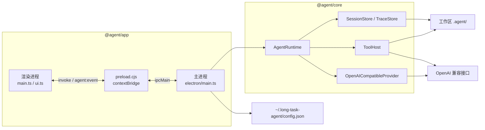
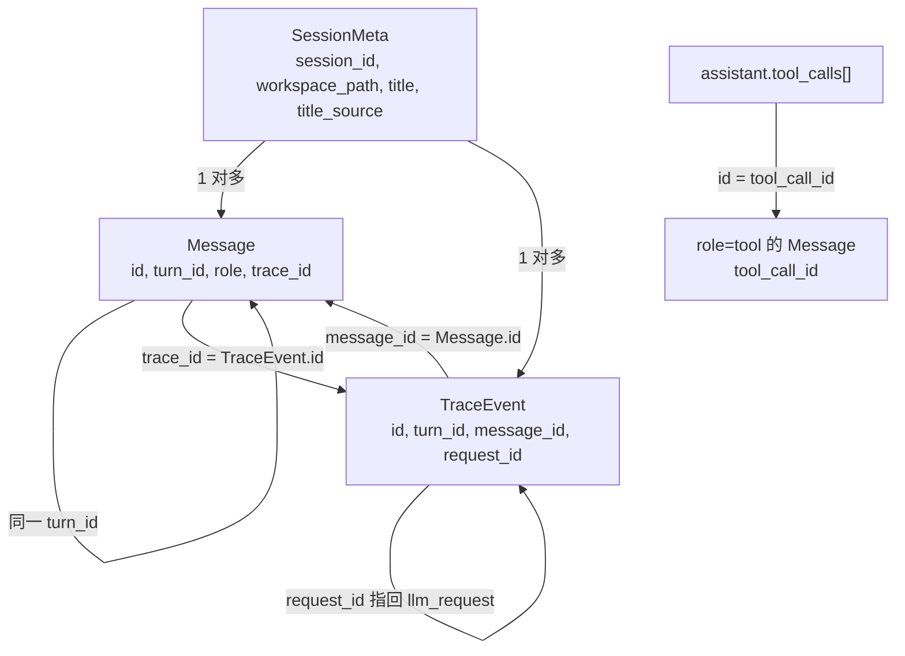

# 长任务桌面 Agent

本仓库是一个本地 Electron 客户端。它在用户选定的工作区里跑可中断的 ReAct：向 OpenAI 兼容接口流式要模型输出，按模型给出的工具调用去读改文件、跑命令或搜索，并把对话与审计分开落在工作区里。换工作区不会串历史。密钥只留在本机用户目录。

界面是一块独占的主区：会话页，加上 `meta.json`、`messages.jsonl`、`trace.jsonl`、`context.jsonl` 四个文件页，各占整页。输入框浮在内容上，不占一条横贯的底栏。

## 系统架构

渲染进程没有 Node。它只通过 preload 上的 `window.agent` 说话。主进程持有当前工作区上唯一的 `AgentRuntime`。运行时、存储、工具和模型客户端都在 `@agent/core`，不依赖 Electron，可以用 vitest 单独测。



约束：

- 侧边栏可以记下多个工作区，点 + 是增加，不会换掉已有的那一条。点工作区名字或旁边的箭头，只展开或折叠该目录的会话，不换掉右侧正在看的页面。点开某个会话才会显示它。任务进行中仍可点开别的会话查看，发送和输入都是灰色，不能打字。那一页的输入框里用绿色写「另一个会话正在执行」，不把正在跑的阶段提示带到这一页。停止和「等待确认权限」这类实时状态只在正在执行的那个会话页上。左侧该会话标题前有一枚发送按钮同色的转圈；工作区若被折叠，转圈改标在工作区名字前。工作区的展开和折叠记在本机配置里，重启后保持。输入框跟页面绑定：新建会话页和每个会话各留自己的草稿，切走再切回来还在，不会带到别的会话里。同一时刻只有一个 `AgentRuntime`。
- 一个 runtime 同时只跑一轮 `submit`。再提交会得到 `busy`。正在执行的那一页，发送按钮变成「停止」；其他会话页的发送保持灰色，不能从那一页停止。停止走 `cancel()`。
- 主进程打开窗口时打开 `contextIsolation`，关闭 `nodeIntegration`，并拒绝页面内导航和新窗口。preload 必须编成 CommonJS（`preload.cjs`），沙箱里不能用 ESM。
- 应用从 `packages/app/dist` 启动。改了渲染层的 TypeScript 要重新 `build`；只改 `index.html` 或 `styles.css` 时，构建末尾的静态拷贝会把它们抄进 dist。

## 保存模型配置

在「配置模型」里保存，只把 Base URL、模型和密钥写入 `~/.long-task-agent/config.json`，不拆掉正在跑的任务。权限确认和「等你回答」继续挂在原来的 runtime 上。这一轮里后面的每次模型调用，仍用这一轮开始时的地址、模型和密钥。一次发送里面可以有多次模型调用，这些调用不会中途换配置。

下一次点发送时，若磁盘上的配置和当前 runtime 不一致，才丢掉旧对象，按新配置再建一个。模型和供应商是创建 runtime 时定下来的，所以生效方式是换一个新对象，不是在正在跑的对象上改字段。正在跑的时候再发送会得到 `busy`，不会趁这次发送把 runtime 换掉。停止仍然作用在这一轮的 runtime 上。

换工作区仍会换掉 runtime。会话目录和工具的工作区路径绑在这个对象上，和模型配置不是同一件事。

### `@agent/core`

| 模块 | 职责 |
| --- | --- |
| `runtime/agentRuntime.ts` | 一轮对话的状态机：落库、组装上下文、流式调用、执行工具、取消、自动标题。同一条回复里的多个 `subagent` 一起跑，其余工具按顺序 |
| `runtime/subagentRun.ts` | 一个子代理的独立循环。自己的上下文，回给父会话的只有一条回执 |
| `runtime/permission.ts` | 写操作的许可门。Electron 用 `DeferredPermissionGate`，测试可用 `AutoAllowGate` |
| `provider/openaiCompatible.ts` | 把组装好的消息打成 chat-completions 流，解析文本、工具调用和 token 用量 |
| `context/assemble.ts` | 发给模型的顺序：system（含工具说明）→ 压缩后的历史 → 当前用户消息 |
| `context/compress.ts` | 只压缩「这一次发给模型的副本」。用户轮次超过 10 时保留前 3 轮和后 10 轮，中间收成摘要，再按字符上限截断。磁盘上的 jsonl 不动 |
| `context/repairToolCalls.ts` | 崩溃或取消后，给没有结果的 `tool_call` 补一条合成 tool 消息，避免下次请求因不成对而失败 |
| `store/sessionStore.ts` | 会话目录、`meta.json`、`messages.jsonl`。列会话时只看 `sessions/` 下的直接子目录 |
| `store/subagentStore.ts` | 子代理的四个文件，放在所属会话的 `subagents/` 下，不会被列成另一个会话 |
| `store/taskStore.ts` | 本会话的任务清单。一个任务一个 JSON。目录锁让同一次领取只有一个成功 |
| `store/inboxStore.ts` | 本会话的完成通知队列。只追加的 `inbox.jsonl`。先认领再写入消息，崩溃后用同一条消息 id 补写 |
| `context/taskReminder.ts` | 连续 10 条助手回复没碰任务工具、且还有未完成任务时，给这一次请求附上清单 |
| `store/traceStore.ts` | 只追加的 `trace.jsonl` |
| `tools/host.ts` | 内置工具表。未知工具和参数解析错误都变成 `is_error` 的工具结果，不抛出循环。`subagent` 在这里不执行，由 runtime 接手 |
| `tools/agentTool.ts` | `explore` / `worker` 的系统提示词、工具上限、回合上限、回执截断，以及可选的 `task_id` |
| `tools/taskTools.ts` | 清单的创建、查看、修改、删除、领取和完成 |
| `tools/writeScope.ts` | `output_dir` 必须是工作区内的相对目录；同一批里重叠的目录互相挡住。文件工具也不能写进 `.agent` |
| `tools/policy.ts` | 把一次调用分成 `read` / `write` / `blocked` |
| `tools/fsSandbox.ts`、`pathSandbox.ts` | 文件类工具的路径必须落在工作区内 |
| `config/loadConfig.ts` | 读写用户目录里的配置。POSIX 上目录 `0700`、文件 `0600`；Windows 上 chmod 失败会被忽略 |
| `session/autoTitle.ts` | 标题仍是默认值、且不是用户手改时，用本轮内容起一个标题 |

### `@agent/app`

| 模块 | 职责 |
| --- | --- |
| `electron/main.ts` | 窗口、中文菜单、工作区对话框、IPC、把 `RuntimeEvent` 转成 `agent:event`。也记住上次工作区路径。系统菜单不占通栏，收在侧栏里弹出 |
| `electron/preload.ts` | 唯一暴露给页面的 API：`window.agent` |
| `electron/openTarget.ts` | 打开外链。页面不能自己导航 |
| `src/renderer/main.ts` | 工作区与会话列表、会话页和四个文件页的切换、订阅事件、发送/停止、页内搜索 |
| `src/renderer/ui.ts` | 消息气泡、Markdown、工具条、来源块、空状态。不持有会话状态 |
| `src/renderer/runEventGate.ts` | 进行中的事件若不属于当前正在看的会话或轮次，就不往界面上画。`done` 仍会清掉这轮的门闩 |

渲染层三个文件的边界：`main.ts` 决定「现在看哪一页、这轮算不算当前会话」；`ui.ts` 只负责把一块内容画成 DOM；`runEventGate.ts` 是纯函数，用来丢掉过期事件。

## 数据关系

两套落盘，互不写入。

```text
~/.long-task-agent/config.json          密钥、Base URL、模型、上次工作区、可选限额
{workspace}/.agent/sessions/{sessionId}/
  meta.json                             会话身份
  messages.jsonl                        发给模型的对话，一行一条 Message。图片只记相对路径；再次组请求时只有最新一条用户消息上的图片会变成像素
  images/                               用户随提示词上传的图片字节
  trace.jsonl                           审计索引，一行一条 TraceEvent。llm_request 用 context_id 指向 context.jsonl
  context.jsonl                         每次模型调用看见的上下文。图片只记路径和字节数，工具表全文只在哈希首次出现时写一行
  inbox.jsonl                           完成通知队列。一行一次入队、认领或标已写入。模型看不见这个文件，排空后才进入 messages.jsonl
  tasks/                                本会话的任务清单，不是项目文件，也不会被列成会话
    {id}.json                           一个任务。编号是十进制字符串，删掉也不复用
    .highwatermark                      用过的最大编号
  subagents/{subagentId}/              一次 subagent 调用的独立落盘，不是另一个会话
    meta.json                           类型、父工具调用 id、output_dir、状态
    messages.jsonl                      子代理自己的对话。中间阅读和搜索留在这里
    trace.jsonl
    context.jsonl
```

`sessionId` 只能是一段路径名（字母、数字、下划线和连字符），避免被拼进目录时逃出 `.agent/sessions/`。



一条用户消息打开一个 `turn_id`。这一轮里的助手文本、工具调用和工具结果都带同一个 `turn_id`。`messages` 是模型下一次能看见的历史；`trace` 是同一次动作的审计。两边用 `trace_id` / `message_id` 互指。`llm_response` 和 `llm_error` 再用 `request_id` 指回对应的 `llm_request`。每一条 `tool_result` 同样用 `request_id` 指回它的 `tool_call`。

`role=tool` 的消息可以带 `tool_call_arguments`，只给界面和审计看。组装上下文时不会把它再发给模型，因为参数已经在配对的那条助手消息的 `tool_calls` 上。

标识前缀：`sess`、`turn`、`msg`、`trace`、`perm`、`subagent`、`note`。早先的子代理目录是 `agent_…`，重开时仍会读。`inbox.jsonl` 不在四个文件页里。

配置里的 `apiKey` 不会出现在 messages、trace 或 context 里。`llm_request` 只记模型名、条数、字数、图片张数和 `context_id`。这个 id 就是 `context.jsonl` 里对应请求行的 `id`，文件字段名不改。四个文件页里，`messages.jsonl`、`trace.jsonl`、`context.jsonl` 都按条折叠：标题是序号、角色或事件类型，再加一行摘要；展开后是这一条的 JSON，超过 1600 字的字符串截断。`meta.json` 是整份 JSON。用当前页搜索 `context_id` 即可定位。`user_message` 这条 trace 只记字数，不记正文。

## 一轮提问

1. 渲染进程 `submit(sessionId, text)`。主进程交给当前 runtime。
2. 先补齐磁盘上悬空的工具调用，再追加 `turn_start`。若 `inbox.jsonl` 里还有没写进对话的完成回执，先收成一条 `task-notification` 用户消息，再追加你的用户 `Message` 和 `user_message` trace。回执因此排在你这句话前面。
3. 循环直到没有工具调用、被取消、出错或到达 `maxSteps`（默认 50）：
   - 读出全部 messages，压缩副本，装成上下文。若连续 10 条助手回复没调用任务工具、且还有未完成任务，这一次请求的 system 末尾附上这些任务。附注不写入 `messages.jsonl`。
   - 流式请求模型。文本增量以 `text` 事件推到界面；工具调用以 `tool_call` 事件推送。
   - 没有工具调用时先排空 inbox。写出了回执就再请求一次模型，不结束这一轮。队列空了才 `done(completed)`，并视情况自动改标题。只有回执、没有人说话的轮次不计入自动标题。
   - 有工具调用则 `steps` 加一。同一条回复里、`ask_user` 之前的多个 `subagent` 一起执行。其余工具按顺序执行。
4. 每个工具先经 `classifyToolCall`：
   - `read`：直接执行。
   - `write`：发出 `permission_request`，等界面允许或拒绝。允许一次即放行这一轮剩下的写操作和命令；拒绝只否定这一次，写成一条错误工具结果，循环可以继续。`ask_user` 不在这次放行里。
   - `blocked`：不执行，写成错误工具结果。上一轮的允许也不会把这类命令放出来。
5. 每条工具调用先写一条 `tool_call` trace（工具名、参数）。真正执行的记在开跑之前；拒绝、停止、未执行而收口的记在结果前面，两条时间会贴在一起。然后追加 `role=tool` 的消息和 `tool_result`。`tool_result.request_id` 指回这条 `tool_call`。拒绝、停止写在结果的 `denied` / `cancelled` 上，不写进开始记录。`duration_ms` 只出现在真正执行过的结果上，不算等你点允许的时间。这一批工具结果都写完之后先排空 inbox，再回到第 3 步。完成回执是排在这些 `tool` 消息后面的另一条用户消息，不是同一次工具调用的第二条结果。
6. 取消会留下已经流出的文本（标成 interrupted），停掉正在跑的 shell，尚未执行的工具调用用合成结果收口，并写 cancel trace。

`maxSteps` 数的是「模型返回了一批工具调用」的次数，不是单次 HTTP。一批里有三次 `web_search`，这一轮只把 `steps` 加一，但会打出三次搜索请求，外加这一轮的对话补全请求。搜索和 token 是两笔用量。

## 工具

| 工具 | 风险 | 说明 |
| --- | --- | --- |
| `read_file`、`list_dir`、`keyword_search` | 自动放行 | 路径限制在工作区内。读和搜索有字符与条数上限。`keyword_search` 可指定一个文件或目录，并一次传入多个词；不给路径时搜整个工作区。超过 1MB 的文件跳过。已请求停止时，在下一个目录或文件之前停 |
| `subagent` | explore 自动放行；worker 确认一次 | 派一个子代理。可带 `task_id`，把清单上的一条任务交给它。见「子代理」 |
| `task_create`、`task_list`、`task_get`、`task_update`、`task_delete`、`claim_task`、`complete_task` | 自动放行 | 只改本会话 `.agent` 里的清单，不改项目文件。见「任务清单」 |
| `web_search` | 自动放行 | 一次调用向 `{llmBase}/v1/tools/search` 发一个 POST。`count` 默认 8、最大 50。`need_content` 为 false，返回的是摘要不是整页。查询最长 128 字 |
| `ask_user` | 停下来问人 | 同一轮挂起，直到用户回答。回答写成这条工具调用的结果，然后模型继续。同一条回复里排在它后面的工具不会执行。只把问题打印出来、不调用这个工具，会结束这一轮 |
| `write_file`、`str_replace`、`delete_file` | 这一轮确认一次 | 路径同样不能逃出工作区，也不能落进 `.agent`。点「允许这一轮」后，同一次发送里后面的写操作不再逐条询问 |
| `powershell`（Windows）/ `bash`（其他系统） | 看命令 | Windows 上启动 `powershell.exe`，工作目录是 Windows 路径。只读命令，以及不落盘的 `curl` / `Invoke-WebRequest` / `Invoke-RestMethod`（不是 POST、PUT、DELETE、PATCH，也没有 `-OutFile`、`-o`）自动放行。其余需确认，允许一次覆盖这一轮剩下的命令。清空磁盘根目录仍直接拦截。超时默认 60 秒，输出会截断。旧会话里的 `bash` 调用会返回错误，不再进入 WSL |
| 未知工具 | 需确认 | 分类上按写操作对待；宿主找不到实现时返回错误结果 |

界面上每个工具条按 `tool_call.id` 和后来的 `tool_result.tool_call_id` 配对。同名工具不会合并：合并会藏掉不同的查询，也不能少计一次已经发出的请求。

## 任务清单

多步、且后面依赖前面的工作记在本会话的 `tasks/` 下。一个任务一个 JSON。不放在项目根，以免被 git 看见、被两个会话共用，或被 `write_file` 直接改掉。`list_dir` 和 `keyword_search` 本来就跳过 `.agent`。

编号从 `1` 起。删掉的编号不复用，所以对话里说的「#2」不会在删除之后指到另一件事。

状态只有三种：`pending`、`in_progress`、`completed`。被挡住不是第四种。一条 `pending` 的任务，只要 `blockedBy` 里还有没完成的编号，或者那个文件已经不在，就不能领取。`blocks` 是反向的一条边，删除时用来把对方的引用清掉。`task_list` 只把还没完成的前置标成 blocked；磁盘上仍保留已经完成的前置。

| 工具 | 谁可以调用 | 做什么 |
| --- | --- | --- |
| `task_create` | 父会话 | 新建一条 `pending`。`blocked_by` 可以在这时写上。编号由清单分配 |
| `task_update` | 父会话 | 改标题、说明或依赖。不改状态。依赖只能在 `pending` 时改 |
| `task_delete` | 父会话 | 删掉这一条，并把它从其他任务的 `blocks` / `blockedBy` 里去掉。编号不复用 |
| `task_list`、`task_get` | 父会话和子代理 | 看清单或一条的说明 |
| `claim_task` | 父会话和子代理 | `pending` → `in_progress`，写下 `owner`。前置没完成就失败。同一次领取只有一个成功 |
| `complete_task` | 父会话和子代理 | 只有领取它的 `owner` 能把它收成 `completed`，并在结果里列出因此可以开始的任务 |

父会话省略 `owner` 时记成 `main`。子代理省略时记成它自己的 `subagent_…`，不能改成 `main`。子代理不能创建、修改或删除任务，也不能给另一个子代理发消息。它们只通过这条清单知道上一件做完了没有。

把清单上的一条交给子代理时，在 `subagent` 上带 `task_id`。runtime 在它启动前用它的 id 领取。父会话不要自己先领走。这一条被挡住，或已经有主人，子代理不会启动，工具结果就是这次失败。运行结束时，这个 id 名下还停在 `in_progress` 的任务退回 `pending`，回执里写明。已经 `complete_task` 的不动。成功结束但忘了完成，同样会退回，因为这个子代理不会再调用工具。

连续 10 条助手回复都没有调用任务工具，并且还有未完成任务时，下一次模型请求的 system 末尾附上这些任务。这条附注不进 `messages.jsonl`。调用过任务工具，或清单里没有未完成任务，就不再附。计数记在进程里，重启之后重新数。

Shell 仍然可以写进 `.agent`。文件工具这条路已经堵住。

## 完成通知

后台结束的结果先进入 `{session}/inbox.jsonl`，不直接改 `messages.jsonl`。同一条完成的 id 只保留第一次。文件只追加，不整份重写：一行 `enqueue`，排空时再追加 `claim` 和 `consumed`。

模型下一次能看见的仍是 `messages.jsonl`。runtime 把还没写入的行收成一条 `user` 消息，`name` 是 `task-notification`。一次排空合成一条，正文写明这是完成回执，不是用户的新指令。单条最长 6000 字，整条通知最长 24000 字。`claim` 先落盘，上面带着将要使用的消息 id；消息写入之后才追加 `consumed`。两步之间崩溃，下次排空补的是同一条，不会再写一条。这条回执沿用当前轮的 `turn_id`，避免把这一轮已经读过的技能收成一行。

三个写入点：

- 这一批工具结果全部写完之后、下一次模型请求之前。
- 模型这一步没有工具调用、本要结束时。写出了回执就再请求一次，不发 `done`。
- 没有回合在跑，并且界面正打开这个会话。入队的一方自己开一轮续跑。没被打开的会话只留在队列里，等被打开，或等下一次发送。

取消和到达 `maxSteps` 不再开一轮。队列留着，下一次你自己的发送会在你的那句话之前把它们写入。

续跑占用现在这一把 `running`。输入框仍可打字：空着时按钮是停止，有字时是发送。这句话先留着，排在回执后面，跟下一次模型请求一起送出。普通用户回合里再发送，仍会被告知这一轮还在跑。

界面把这条画成「后台完成」，不画成用户气泡，也没有「重新问」。进程重启后队列还在；只有当前打开的会话会自动续跑。

`postTaskNotification` 是入队的入口。`subagent` 的 `delivery` 默认 `joined`：这一轮等到回执，工具结果就是回执，结束时不入队。`deferred` 立刻返回受理，子代理用自己的中止信号继续跑；它自己的运行结束时才调用这个入口。父回合结束、或你点了停止，都不会取消已经受理的那一次。

## 子代理

主模型不临时编写子代理。它调用 `subagent`，选定已有类型，并写一段能单独执行的任务。身份在定义时就定了：系统提示词、工具和回合上限都在 `tools/agentTool.ts`。任务正文最长 20000 字。`description` 是界面上的短标签，超过 200 字会截断。

现在只有两种：

| 类型 | 能做什么 | 回合上限 |
| --- | --- | --- |
| `explore` | 只读。工具是 `list_dir`、`read_file`、`keyword_search`、`web_search`、`read_skill`，外加清单的查看、领取和完成。不接受 `output_dir` | 8 |
| `worker` | 上面这些，再加上 `write_file`、`str_replace`、`delete_file`。写入只能落在 `output_dir` 里 | 16 |

这里的回合，数的是「子代理一次回复里带了工具调用」。同一回复里的多次搜索只算一回合。父会话的 `maxSteps` 若更小，子代理跟着用更小的数；父会话调大不会把子代理放宽。每条工具结果开头写着还剩几回合。用完之后，这一回复里再来的工具调用被跳过，子代理停住。

两种都不能跑 shell、不能 `ask_user`、不能再调用 `subagent`，也不能跑 `run_skill_script`。它们可以 `task_list`、`task_get`、`claim_task`、`complete_task`，不能 `task_create`、`task_update`、`task_delete`。任务正文里再写一份工具清单不会生效。选类型就是工具限制。`task_id` 由 runtime 在启动前领取，不需要写进任务正文。

父会话的系统提示要求任务写清四件事：为什么做、做什么和不做什么、怎样算完成、子代理自己拿不到的路径和约束。不要把「根据你的发现去修」派出去。验证命令由父会话在回执回来之后自己跑，因为子代理没有 shell。

子代理看不见父会话的对话，父会话也看不见它的中间阅读。它有自己的模型循环和自己的 `turn_id`，文件在 `{session}/subagents/subagent_…/`。列会话只扫 `sessions/` 的直接子目录，所以这些目录不会变成左侧的一条会话。主区也不打开这四个文件页。

`delivery` 省略或留空都是 `joined`。这时回给父会话的工具结果就是回执，最长 6000 字。正文是子代理最后一段话，再加上它写过的路径。超长时截断正文，尽量留下文件列表。交付物是文件本身，回执不贴文件正文。`deferred` 的工具结果只是受理，写明子代理 id；回执稍后经完成通知进来，同样最长 6000 字。在那条通知写入会话之前，不要改文件，也不要把一次 deferred 的 explore 当成已经到手的证据。

同一条助手回复里、`ask_user` 之前的多个 `subagent` 用 `Promise.all` 一起跑。`joined` 会让父模型等到它们结束再继续生成。`deferred` 只把受理放进这一批的工具结果，父模型不必等它跑完。`explore` 自动放行。`worker` 按写操作确认一次；这一轮里点过允许之后，后面的 `worker` 不再逐个询问。同一回复里两个 `output_dir` 相同或互相包含时，后一个不启动。和仍被 deferred 占着的目录重叠，也不会启动。父会话往这些目录写会被拒绝。`joined` 的目录只锁到这一批结束。`deferred` 的目录要锁到回执写进会话之后，下一次模型请求才碰得到。`output_dir` 必须是工作区里的相对目录，不能是工作区根，不能含 `..`，也不能落在 `.agent` 下。

界面上，子代理的工具行缩进在启动它的那一行下面，不折进那一行的详情。这些事件仍用父轮次的 `turn_id`，并带 `parent_tool_call_id` 和 `session_id`。父回合结束、或后面另起一轮续跑时，事件门不再把它们丢掉：你还看着这个会话，行就直接出现在受理那一行下面。你当时在看别的会话，行不会画到那边去；回到这个会话时，停放着的那份对话会补上，否则从子目录的 `messages.jsonl` 装回来。

点停止只把这一轮的中止信号置上，按钮变成灰色的「正在停止」，直到 runtime 发出 `done` 才变回「发送」。还没返回受理的 `deferred` 不会启动。已经受理的继续跑，停止不会取消它。`joined` 的子代理在每次模型请求之间、以及同一批工具的下一个之前看这个信号。`keyword_search` 在每个目录和每个文件之前也看。正在读的那一个文件不会被从半截拆掉。

还没有：自定义类型、子代理再派子代理、同一工作区里多个会话同时跑。`joined` 时父模型仍要等子代理结束才继续生成。`deferred` 受理之后可以继续想下一步，回执经完成通知进入下一轮。


*deepseek阅读工具系统代码后的亮点总结：*

> # **AI Agent 工具系统（Tool System）设计亮点**
>
> 本项目的工具系统（`src/tools/`）不仅是 LLM 与本地系统交互的“双手”，更是一套兼顾高扩展性、强安全性以及工业级健壮性的底层基建。
>
> ## **一、 核心架构与接口设计**
>
> ### **1.** `types.ts` **- 严谨的接口契约**
>
> - **环境与展示分离**：`ToolDefinition` 纯粹用于给大模型看（序列化后作为 function calling 的 schema 注入 Prompt）；而 `ToolContext` 纯粹给本地运行时看（携带绝对路径、超时限制、API Key、中断信号等敏感/环境信息），绝不泄露给 LLM。
> - **标准化输出**：强制所有工具返回 `{ content: string, is_error: boolean }`，保证 LLM 能统一理解执行结果是成功还是失败。
>
> ### **2.** `host.ts` **- 控制反转的调度枢纽**
>
> - **注册与分发**：作为 Tool 的“大管家”，屏蔽了上层业务对具体工具的感知，通过 `Map` 统一管理工具的注册与执行。
> - **异常兜底**：在 `execute` 入口处严格捕获 `JSON.parse` 解析错误和工具内部的运行时异常，防止 LLM 发癫传入错误参数导致整个 Node 进程崩溃。
>
> ## **二、 顶尖的安全防御机制（Security & Sandbox）**
>
> ### **3.** `fsSandbox.ts` **- 绝对防御的路径沙箱**
>
> - **防路径穿越与软链接逃逸**：全面使用 `realpath` 解析文件的真实物理路径，并通过 `isPathInside` 严格校验，杜绝 AI 越权访问工作区外部的系统文件。
> - **防深层溯源漏洞**：在创建（写入）未知的深层目录时，采用**“向上溯源”**策略。通过 `access` 找到第一个真实存在的父目录，确权后才逐层 `mkdir`，并在写入后再次复核，完美防御 TOCTOU（竞争条件）攻击。
>
> ### **4.** `dangerous.ts` **&** `policy.ts` **- 分级拦截与安检门**
>
> - **危险操作黑名单**：`dangerous.ts` 直接用正则一票否决高危命令（如 `mkfs`、针对根目录的 `rm -rf /`、底层 `dd` 写入等）。
> - **读写分级与 Human-in-the-loop**：`policy.ts` 对 Bash 命令进行语法级别的深度解析（剥离引号、拆分管道、识别重定向 `>`）。将行为分为 `read`（直接放行）、`write`（触发用户弹窗确认）和 `blocked`（直接拦截），在用户体验与安全性之间找到完美平衡。
>
> ## **三、 工业级的运行时健壮性（Robustness）**
>
> ### **5.** `bash.ts` **- 全副武装的执行器**
>
> - **跨平台进程树击杀**：专门针对 Windows 平台使用 `taskkill /T /F`，同步强杀子进程树，解决 Git-Bash 等环境下孤儿进程占用文件（EBUSY）的痛点。
> - **流式内存截断（防 OOM）**：在 `stdout`/`stderr` 接收数据块（Chunk）时实时累加长度。一旦超出 `maxToolOutputChars` 预算，立即强杀进程并返回截断数据，防止 `cat` 大文件导致 Node.js 内存溢出。
> - **命令长度限制**：禁止 AI 使用 Bash 的 `echo/heredoc` 写入大文件，强制其使用专用的文件工具。
>
> ### **6.** `listDir.ts` **- 带过滤器的目录扫描**
>
> - **防 Token 爆炸**：强制硬编码跳过 `node_modules`、`.git`、`.agent` 等黑洞目录。
> - **容错与跨平台**：遍历时忽略无权访问或损坏的死链接，并强制统一路径分隔符（`\` 转 `/`），保证不同操作系统下输出格式的一致性。
>
> ### **7.** `strReplace.ts` **- 精准的代码微雕刀**
>
> - **唯一性校验防呆**：默认执行单次替换，如果 `old_string` 在文件中出现多次，则报错拒绝执行。强制 AI 提供更丰富的上下文以保证唯一性（或显式传 `replace_all: true`），避免“误伤”其他代码。
>
> ### **8.** `deleteFile.ts` **- 受控的文件粉碎机**
>
> - **拒绝目录删除**：通过 `stat` 二次校验，仅允许删除具体文件，拒绝目录删除操作，防止 AI 一键抹除项目源码。
>
> ### **9.** `readFile.ts` **- 带限流阀的阅读器**
>
> - **读取截断保护**：内置 `maxReadChars` 限流保护，防止 AI 读取超大文件（如编译产物或日志）直接击穿 LLM 的 Token 限制。
>
> ### **10.** `search.ts` **- 高效的关键词嗅探器**
>
> - **大文件跳过**：在遍历检索时，利用 `stat` 检查文件大小，直接跳过超过 1MB 的巨型文件，保证检索性能。
>
> ### **11.** `webSearch.ts` **- 连接真实世界的顺风耳**
>
> - **输入与输出净化**：严格限制查询词长度（128 字符），针对 API 返回的杂乱 JSON，格式化为带序号的 Markdown 链接和摘要，极大降低 LLM 的解析负担，并引导其规范引用来源。
>
> ---
>
> **💡 架构总结：**  
> 本工具系统遵循了**“把 LLM 当作聪明的盲人”**的设计哲学：对外提供极简且安全的接口，对内做好极端的防呆（防崩溃、防越权、防爆内存）。任何工具只需实现 `Tool` 接口，即可无缝接入 Agent 的武器库。

## 界面

主区四个标签互斥，点哪一个就只显示那一页。侧栏换会话时回到「会话」页，并直接跳到对话底部，不做平滑滚动。

`Ctrl+F` 只搜当前这一页，按大小写不敏感的原文包含来比，不用正则。高亮用 CSS Highlight API，不改写 Markdown 的 DOM。对话页搜气泡和工具结果；四个文件页搜各自的 JSON。换页会沿用关键字，并从该页第一处重新数。被链接或加粗从中间切开的词对不上，因为比对是按可见文本节点做的。

输入框是浮在主区底部的白卡片，不占文档流。对话和文件视图铺满到窗口底，滚动区底部留出与卡片等高的空白，避免最后一行被挡住。确认写操作的卡片叠在输入框上方，同样不铺一条底栏。

当前会话有任务时，输入栏左侧、图片按钮旁边出现「任务」和条数。清单是空的就不显示。有进行中或被挡住的，数字用警告色，发送按钮仍是唯一的强调色。点开后在输入卡片上方列出本会话的任务，只读：进行中、被挡住、待做，已完成默认折起。被挡住的写明卡在哪一条。进行中且领取者是已经结束的子代理，标成「领取者已结束」。技能页和四个文件页不放这个按钮。确认卡出现时，任务面板在它上面。

会话行的「⋯」菜单挂到 `document.body`，避免被侧栏的滚动容器裁切。侧栏本身不滚动；会话多出来时只滚列表，且不画滚动条。点开菜单的那一行会铺上和当前会话相同的绿色，菜单关闭后褪去。当前会话的绿色仍然保留，所以两行可以同时是绿的：一行表示正在看，一行表示菜单目标。

## 开发

```bash
cd long-task-desktop-agent
npm install
npm run test -w @agent/core
npm run build -w @agent/core
npm start -w @agent/app
```

`npm start` 会先构建 core 再启动 Electron。改了界面后需要重新构建再打开应用，否则窗口仍加载上一份 dist。

## 现在还不做

没有跨会话记忆，没有用户自定义工具，也没有右侧检视面板。文件页就是主区里的四个标签，不是分栏。子代理只有 `explore` 和 `worker` 两种，不能再派子代理。`joined` 时父模型要等它结束；`deferred` 受理后父模型可以继续，回执由完成通知在当前打开的会话上续跑。子代理的四个文件不在主区打开。父回合结束后，deferred 子代理的工具行仍会画在当前打开的这个会话里，不会为此把回合重新打开。

旧说明里写过「不做 web」。这已经不对：`web_search` 是内置工具。
