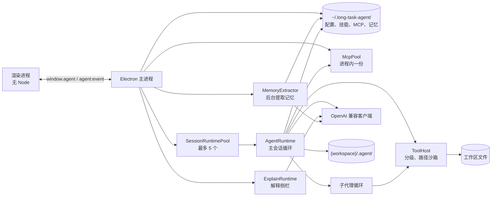

# 长任务桌面 Agent

一个本地 Electron 客户端，让模型在你选定的项目目录里完成长任务：读写文件、运行命令、联网搜索，把独立的工作派给子代理，或调用已连接的 MCP 服务。还可以按模型类型生成图片或视频，或在对话里附上图片和视频。

- 写操作需要你确认，一次确认覆盖这一轮剩下的写操作。
- MCP 调用默认每次单独确认，除非该服务打开了自动放行。
- 任何时候都可以停止这一轮。
- 模型每次请求实际收到的上下文都落在磁盘上，事后可以对照。


上图中，主代理派出一个 `deferred` 的 `worker` 子代理。子代理的工具行缩进在受理那一行下面，失败的一行标红。子代理做完后，回执以「后台完成」卡片回到对话。

## 能做什么

- **读写与搜索。** 在工作区里读、搜、改文件，运行 PowerShell 命令，联网搜索。读文件时，短文件整读；长文件先用搜索定位行号，再按行段读取。
- **多会话。** 最多 5 个会话同时执行，不限是否同一工作区。侧栏的圈表示这条会话仍占着一个名额：父轮次结束后，只要 deferred 子代理还在跑，圈就继续转。同一工作区不会另开目录，两条会话写同一路径时，后写的覆盖先写的。
- **子代理。** `explore` 只读，`worker` 只能写指定目录。可以等它做完（`joined`），也可以先做别的，等完成通知（`deferred`）。
- **任务清单。** 多步、有依赖的工作记成本会话的任务清单，子代理按依赖领取。
- **技能。** 带 `SKILL.md` 的文件夹，用来扩展说明和脚本，用 `/技能名` 显式调用。
- **MCP。** 连接本机 stdio 服务，或一条 Streamable HTTP 服务。工具只进主会话，名字带 `mcp__` 前缀。
- **记忆。** 跨会话记住偏好、纠正和项目里看不出来的事实。一轮正常结束后在后台写入，下一轮自动带上。在首页侧栏点「记忆」查看和修改。
- **模型。** 在侧栏「模型」里添加多条模型，每条有类型，缺省为生文。可以复制一条。在输入框旁选择当前要用的那一条，发送时按它的类型处理，不会根据你的话猜测。
  - **生文**：走对话补全，可以附带最多 4 张图片和 1 个视频。
  - **生图**：请求 `${baseUrl}/images/generations`。模型页按 Doubao-Seedream-5.0-pro / 5.5 / 5.0-flash 三个型号 Tab 保存各自的尺寸档位（1K / 1.5K / 2K 与自动 / 1:1 / 4:3 / 3:4 / 16:9 / 9:16）、输出格式（png / jpeg）、背景（opaque / transparent，5.5 另有 auto）、水印和提示词优化（仅 5.0-pro 有 fast）；Model 可填官方 ID 或 `ep-...` Endpoint ID。生成时先按模型默认发，再合并生图标签摘要芯片里的本轮覆盖；透明背景强制 PNG，且只在恰好附 1 张参考图时发送，不满足时回退到该型号的非透明默认背景。生成的图出现在助手气泡里。
  - **生视频**：走派欧云 MiniMax H3 异步协议（创建任务再查询）。Base URL 填 `https://api.ppio.com`（勿带 `/v1`）。型号为 Lite / Highspeed / Max / H3 四档，各自保存素材模式、分辨率、可生成时长范围和画幅；默认时长取范围下限。生成的视频写入会话的 `videos/`，出现在助手气泡里。**参考素材**模式可附图片（≤9）/ 视频（≤3）/ 音频（≤3），请求体带 `reference_image` / `reference_video` / `reference_audio`；不能只附音频。对话内本轮覆盖时长/分辨率/模式仍未做。
  - **语音合成（TTS）**：走火山豆包 openspeech HTTP（`seed-tts-2.0`）。输入文本后，音频写入会话 `audios/`，在助手气泡里播放。方舟 Agent Plan 的 Base URL 只作开通/计费占位，运行时忽略并改打 openspeech；请用豆包语音专属 Key（`X-Api-Key`）。
  - **语音识别（ASR）**：上传一段音频可转写为文本；输入框旁麦克风听写写入草稿（不自动发送），使用旁路「当前听写」模型（`currentAsrModelId`）。WebSocket 端点为 nostream（上传）/ async（麦克风）。
  - **网搜**：只给 `web_search` 用，不出现在输入框的选择器里。在模型页点它的「使用」，它和对话模型各有一个「当前」，同时生效。换对话模型不影响搜索。
- **图片查看。** 对话里的图片可以点开，在应用内的查看器里放大、缩小，并切换同一条消息里的其他图片，不会调用系统看图软件。
- **需要你拿主意时停下来。** 遇到写操作，或者需要你判断时，会停下来等你。
- **答案解释。** 在右侧「答案解释」里拖入一段文字，得到 200 字以内的简答。解释栏只用生文模型，有自己的选择器，不上传图片或视频。
- **会话文件。** 每个会话的 `meta`、`messages`、`trace`、`context` 四个文件可以直接在主区打开。

## 设计要点

### 1. 三份日志，各管一件事

**问题：** 长任务跑偏时，需要回答「模型当时看见了什么」。发送前，上下文会在副本上被换成短桩或整条丢弃，磁盘上的对话回答不了这个问题。

**做法：** 每个会话写三份只追加的 JSONL：

- `messages.jsonl`：模型下次能看见的对话。
- `trace.jsonl`：审计事件。
- `context.jsonl`：每次模型调用实际发出的上下文。工具定义按 sha256 去重，生图请求不带工具，图片只记路径和大小。

三者用 `trace_id`、`message_id`、`request_id`、`context_id` 互相指认。


上图是 `context` 文件页。第 20 条是一份工具定义，紧接着的第 21 条请求用 `tools_sha256` 指向它，不再重复存一份。

**代价：** 同一段内容在三份文件里各存一份，占用磁盘。

详见 [数据模型](docs/data-model.md)。

### 2. 只缩短发出去的副本

**问题：** 长任务的工具结果会把之后每一次请求撑满，但审计记录必须保留全文。

**做法：** 磁盘上的对话只追加，不做摘要。每次请求只在副本上处理，顺序如下：

1. **system**：系统提示、指令文件和记忆、已启用技能的名字和一句话描述、这一轮 `/技能名` 附上的正文，以及任务提醒。正文超过 8000 字时只留前 8000 字，并写明后面还有多少字。
2. **最后一条之前的历史**：
   - 成功的大段写入，以及模型已经看过的失败写入，参数换成一段说明文字，写明路径和字数，并声明这不是参数、不要照抄。
   - 更早的大段工具结果换成一行短桩。
   - 当前用户轮里的工具结果保持原文，但总量有上限（约 `contextCharLimit` 的一半）。超出时从最旧的开始换成短桩。最新一批结果始终保留。
3. **字符预算**：仍超过预算时，整对丢掉最旧的工具往返，再整条丢掉更旧的消息。不会从一条消息的正文中间切开。最早的用户消息和受保护的工具结果保留。最后一条消息不参与丢弃。
4. **修补**：有调用没有结果时，补一条合成的工具结果。只有最后一条用户消息上的图片会变成像素。
5. **工具定义**：放在并列的 `tools` 数组里，本轮开始时拍快照。MCP 工具只在这里，不进 `system`。说明截到 800 字，参数的 JSON Schema 不截断。

**代价：** 预算按字符计，不按 token 计。它只统计消息正文和工具参数，不含 `tools` 数组，所以不是整个请求的硬上限。最早的用户消息和最新一批结果超预算时也保持原文。一次读满的文件仍会完整进入紧接着的下一次请求。超出上限的读取结果会被丢弃，模型只能靠搜索重新定位。

详见 [架构与运行机制](docs/architecture.md#上下文怎么装)。

### 3. 按轮放行的确认门

**问题：** 逐条确认会把人钉在屏幕前，全部放行又不安全。shell 命令尤其难判断：同一串文字，在 bash 和 PowerShell 里的引号、转义和注释规则不同。

**做法：** 每次工具调用分为 `read`、`write`、`blocked` 三档。`write` 停下来等确认，一次「允许这一轮」覆盖这一轮剩下的写操作。shell 命令只有在 bash 和 PowerShell 两套规则下都判为只读时才自动执行；遇到没建模的语法，一律要求确认。

**代价：** 有些其实只读的命令也要确认，比如带脚本块、括号的命令和 `npm test`。更重要的是，这道门守的是「写」：读文件和 GET 请求都不需要确认。因此，「读出敏感内容，再拼进 URL 发出去」这条链路一次点击都不需要，也挡不住网页里的提示注入。它是一道确认门，不是沙箱。

详见 [工具与权限](docs/tools-and-permissions.md)。

### 4. 子代理的类型就是权限边界

**问题：** 大任务的阅读量会撑爆父会话的上下文。但如果让模型自定义子代理，就无法约束它能做什么。

**做法：** 只有两种固定类型。`explore` 只读；`worker` 只能写一个 `output_dir`。两者都不能运行 shell、不能问人、不能再派子代理，也不能调用 `mcp__` 工具。父会话只收一条最长 6000 字的回执，交付物是文件本身。同一条回复里，第一个 `ask_user` 之前的子代理会一起运行，`output_dir` 互斥加锁。父模型什么时候该派子代理、什么时候该写清单，另有一套评测用例（`evals/subagent-multitask/cases.json`）。

**代价：** 子代理的工具调用不经过确认门，只靠工具子集约束。验证命令和 MCP 调用都要由父会话在回执回来后自己做。

详见 [子代理、任务清单与完成通知](docs/subagents-and-tasks.md)。

### 5. 完成通知只在模型「换气」时进入对话

**问题：** `deferred` 子代理随时可能完成。它的回执不能插进一段正在流式生成的回复，也不能因为崩溃而丢失或重复。

**做法：** 回执先写进只追加的 `inbox.jsonl`，只在模型「换气」时排进对话：一轮开始时、一批工具结果之后，以及模型本来要结束时。没有一轮在跑、而你正开着这个会话时，应用会自己开一轮续跑。排空分两步：先落盘一条带消息 id 的 `claim`，写完消息后再记 `consumed`。两步之间崩溃时，下次补写前会先查这个 id 是否已经在对话里，所以不会写出第二条。

**代价：** `deferred` 子代理只活在当时的进程里。重启后，下次打开这条会话或再发送时，仍标着在跑的记录会把领取的任务放回待办，并记成中断。父会话不会收到那次没做完的回执。

详见 [子代理、任务清单与完成通知](docs/subagents-and-tasks.md#完成通知)。

### 6. 技能按需展开

**问题：** 技能装多了会撑爆上下文，但模型又需要知道有哪些可用。

**做法：** 每次请求只带技能的名字和一句话描述。用户写了 `/技能名` 时，正文附进这一轮每次请求的 `system`，超过 8000 字只留前 8000 字。完整附上时，`read_skill` 再读正文会得到「已在上下文中」；被截断的可以再读，这次不要带 `path`。更早的 `read_skill` 结果换成一行。脚本通过 `run_skill_script` 执行，需要确认，并且不经过 shell。完成通知开出的那一轮不附技能正文。续跑期间先暂存的那句话，写进对话之后会附上其中的 `/技能名`；找不到或已停用就跳过，这一轮不会因此失败。通知正文里的名字仍只是文字。

**代价：** 「不要用 shell 读技能目录」这类约束写在提示词里，不是强制的。

详见 [技能](docs/skills.md)。

### 7. 第三方工具另立信任边界

**问题：** 内置工具的副作用可以在本地分级：文件是否出了工作区，命令是否只读。MCP 服务是别人的进程或别人的服务，工具说明也可以由对方填写。如果把它并进「允许这一轮」，一次确认就会放行这一轮里所有未建模的外部调用。把它交给子代理也不行，因为子代理的工具调用不进确认门。

**做法：** 进程里只维护一份连接池，最多 5 个会话共用。每一轮开始时，把当时已连接的工具定义拍进这次循环；中途增删要等下一轮才改变模型看见的工具表。工具名固定为 `mcp__<server>__<tool>`，避免和内置工具撞名，也把函数名限制在 64 个字符以内。传输只有两种：本机 stdio（不经过 shell，不继承父进程里的其他密钥），和 Streamable HTTP（重定向只跟随同一来源，避免查询串里的密钥被带到别的主机）。默认每次调用都单独确认。某个服务可以打开自动放行，只跳过它自己的卡片。子代理和解释侧栏的工具表里没有这些名字。任务清单把调查和写文件派给子代理之后，凡是 `mcp__` 调用仍由父会话执行，再把需要用的事实写进任务。

**代价：** 父会话按清单协调时必须亲自调用外部工具，不能把这一步派掉。自动放行按服务计算，打开后该服务的工具不再询问。连接池活在进程里。同一个用户数据目录再启动一次会退出，并把已有窗口带到前面，所以不会再拉起第二份 stdio 子进程。

详见 [MCP](docs/mcp.md)。

### 8. 记忆只由后台写入

**问题：** 后来的会话用不上先前学到的偏好和纠正。但如果让正在运行的主会话自己写记忆，网页和工具结果里的文字就可能变成以后每一轮都带上的规则。

**做法：** 一轮正常结束后，后台另调一次模型，只读你说过的话，按固定规则校验后写成 Markdown 文件。主会话只能读。你也可以直接改这些文件，或在侧栏「记忆」页修改。

**代价：** 提取发生在这一轮结束之后，模型不能在同一轮里说已经记住了。每轮正常结束都要多一次模型调用。关闭自动记忆后不再写入新的，已有的照常进入上下文。

详见 [记忆](docs/memory.md)。

## 架构

渲染进程没有 Node，只通过 preload 暴露的 `window.agent` 和主进程通信。主进程按「工作区 + 会话」持有最多 5 个 `AgentRuntime`，它们共用一份 MCP 连接池。后台提取另有一个全局队列，一次只跑一个，不占这 5 个名额。运行时、存储、工具、连接池和模型客户端都在 `@agent/core` 里，不依赖 Electron，可以用 vitest 单独测试。



一次发送是一轮 ReAct 循环：模型交替推理和调用工具，直到不再需要工具。

1. **组装上下文**：系统提示、指令文件和记忆、技能目录、这一轮附上的技能正文、任务提醒，再加上处理过的历史。工具定义放在请求的 `tools` 数组里，本轮开始时拍快照，不写进 system 正文。
2. **流式请求模型**：文本增量实时推送到界面。流里带回用量数字时记下来；没有就不补估算值。网关若因为这个用量字段拒绝请求，会去掉该字段再试一次。
3. **执行工具调用**：模型给出工具调用时，逐个分级，需要时等确认，然后执行，结果追加进对话，回到第 1 步。
   - 相邻的只读调用（读文件、列目录、搜索等）同时执行，结果仍按模型给出的顺序记录。
   - 紧挨着的、完全相同的读取不再重复执行，只返回一句说明。
4. **结束**：模型不再调用工具时，先把待写入的完成通知排进对话；没有了才结束这一轮。

后台提取不在这个循环里。一轮正常结束后另调一次模型，见 [后台提取](docs/memory.md#后台提取)。

一轮最多 `maxSteps` 批工具调用。保存新的模型配置不影响正在运行的那一轮：这条会话空下来之后再发送，主进程发现配置变了，才会换一个新的 runtime。

详见 [架构与运行机制](docs/architecture.md)。

## 快速开始

环境要求：

- **Windows。** 目前只在 Windows 上验证过。macOS 和 Linux 上启动时不再加载 Windows 的系统库，但应用没有在这两个系统上实际运行过。
- **Node.js 和 npm。** 在 Node 24 上验证过，更早的版本没有测试。
- 技能脚本需要 PATH 里有 `python` 或 `node`。

```powershell
npm install
npm start
```

根目录的 `npm start` 先构建 core，再构建 app 并启动 Electron。已经有一个窗口时，再开一个会退出，并把已有窗口带到前面。同一个用户数据目录不能同时运行两个进程，包括另一个工作区副本里的 `npm start`。

第一次打开：

1. 点左侧「工作区」旁的 +，选择一个项目目录。
2. 在这个项目的 `.gitignore` 里加上 `.agent/`。会话记录会写进这个目录，里面有模型读过的文件内容和命令输出。
3. 点左下角的「模型」，可以添加多条，每条填写显示名、类型、Base URL、Model 和 API Key。密钥只保存在本机用户目录。在输入框旁选择当前要用的那一条。生视频请选类型「生视频」，Base URL 填 `https://api.ppio.com`，并在表单里为四个型号各自勾选参数。
4. 点「新建会话」，输入任务，按 Enter 发送。

`web_search` 调用 DeepSeek 的搜索接口。推荐在「模型」页添加一条类型为「网搜」的模型，填它的 Base URL 和 API Key，并点「使用」。Base URL 填 `https://api.deepseek.com` 即可，实际请求发往 `https://api.deepseek.com/v1/tools/search`。没有网搜模型时，才读取旧配置 `searchBaseUrl` 和 `searchApiKey`；`searchBaseUrl` 空着就用 `https://api.deepseek.com`。没有密钥时，`web_search` 直接报错。它从不使用对话模型的地址或密钥，所以切换对话模型不影响搜索。返回体仍然只认 DeepSeek 的 JSON；其他服务的格式对不上时，主会话、子代理和解释侧栏里的搜索都会报错。不用搜索的功能不受影响。

## 配置

配置文件在 **agent home** 下的 `config.json`。默认是 `~/.long-task-agent/<本机仓库路径哈希>/config.json`（可用环境变量 `LONG_TASK_AGENT_HOME` 整目录改掉）；每个克隆的路径不同，因此不会共用、也不会互相覆盖。第一次从旧版升级时，最先启动的那一份检出会把原来的扁平 `~/.long-task-agent/` 复制进自己的 `<hash>/`。每次保存前会留下 `config.json.bak`。「模型」页维护模型列表；主输入框先选品类（Chat / 生图 / 合成语音 / 生视频），再选该品类下的模型。`composerKind` 与 `currentModelByKind` 记住品类与各类上次模型；`currentModelId` 与顶层的 `baseUrl`、`model`、`apiKey` 同步当前品类那一条。每条模型有类型（生文、生图、生视频、语音合成 `tts`、语音识别 `asr`、网搜；旧值 `audio` 读入为 `tts`），缺省为生文。解释侧栏另有 `currentExplainModelId`；`web_search` 有 `currentSearchModelId`；麦克风听写有 `currentAsrModelId`（旁路，不占品类 Tab）。

模型页可以复制一条。复制、修改、移除在鼠标移到该条时才出现，「使用」始终在最右侧。工作区相关的字段由侧栏维护，常用文件夹由工作台维护，自动记忆由「记忆」页维护。限额和旧的 `searchBaseUrl`、`searchApiKey` 没有界面，需要直接编辑这个文件。应用保存配置时会保留它们，下次发送时生效。

文件不存在时，应用可以照常打开，但还没有对话模型；发送时会提示先到「模型」页添加，不会悄悄用下面的默认地址去请求。文件存在但不是合法 JSON 时，会改名为 `config.json.broken-<时间>`，启动时弹出备份路径。应用仍以空密钥启动，把备份改回原名后重启即可恢复。下面表格里的 `baseUrl` / `model` 默认值只描述「旧配置没有 models 列表时顶层字段的回退文案」；**缺少配置文件时不会再写入这些 OpenAI 占位**。

| 字段 | 默认值 | 说明 |
| --- | --- | --- |
| `baseUrl` | `https://api.openai.com/v1` | 当前模型的 OpenAI 兼容接口地址。与列表里当前那一条保持一致，方便旧代码读取 |
| `model` | `gpt-4o-mini` | 当前模型名。与列表里当前那一条保持一致 |
| `apiKey` | 空 | 当前模型的密钥，明文保存，只靠文件权限保护。与列表里当前那一条保持一致 |
| `models` | 无 | 已配置的模型列表。每项有 `id`、显示名、Base URL、模型名、API Key 和 `kind`（`text` / `image` / `video` / `tts` / `asr` / `search`，缺省 `text`；旧值 `audio` 读入为 `tts`）。`kind` 为 `video` 时还可有 `video` 与 `videoByModel`；`kind` 为 `tts` 时可有 `tts`（音色、格式、采样率）；`kind` 为 `image` 时可有 `imagePreset`（`Doubao-Seedream-5.0-pro` / `Doubao-Seedream-5.5` / `Doubao-Seedream-5.0-flash`）、`image` 和 `imageByModel`（尺寸、画幅、输出格式、背景、水印、提示词优化；启用透明背景时必须同时启用 PNG）。没有这项时，顶层的 `baseUrl`、`model`、`apiKey` 当作一条 |
| `currentModelId` | 无 | 当前品类正在用的那一条的 `id`。没有或对不上时用该品类列表里的第一条。主输入框旁的选择器改的就是这一项 |
| `composerKind` | `text` | Composer 一级品类：`text`（Chat）/ `image` / `tts` / `video`。缺省为 Chat。语音识别与网搜不在此列 |
| `currentModelByKind` | 无 | 各品类上次选用的模型 `id`（`text` / `image` / `tts` / `video`）。切换品类时恢复 |
| `currentExplainModelId` | 无 | 解释侧栏当前选用的生文模型 `id`。没有、对不上，或那一条不是生文时，改用一条生文模型。解释栏的选择器改的是这一项，不会改掉主对话的当前模型 |
| `currentSearchModelId` | 无 | `web_search` 指向的网搜模型 `id`。没有、对不上，或那一条不是网搜时，改用第一条网搜模型。它和 `currentModelId` 同时生效：网搜模型不会成为对话的当前模型，也不出现在输入框的选择器里。没有网搜模型时，`web_search` 退回旧字段 `searchBaseUrl` / `searchApiKey` |
| `currentAsrModelId` | 无 | 麦克风听写指向的 ASR 模型 `id`。没有或对不上时用第一条 ASR。可与对话模型同时生效 |
| `workspacePaths` | 无 | 侧栏里的工作区列表 |
| `workspaceLabels` | 无 | 侧栏里的显示名，不改目录名 |
| `workspaceCollapsed` | 无 | 折叠起来的工作区 |
| `lastWorkspacePath` | 无 | 启动时恢复的工作区 |
| `favoriteFolders` | 无 | 工作台「常用文件夹」里的目录。点开是在资源管理器里显示，不会变成工作区 |
| `autoMemory` | `true` | 一轮正常结束后是否在后台提取记忆。关掉后不再写入新记忆，已有的照常进入上下文。在侧栏「记忆」页切换 |
| `bashTimeoutMs` | 60000 | shell 命令和技能脚本的超时，单位毫秒 |
| `maxSteps` | 50 | 一轮里模型返回工具调用批次的上限 |
| `contextCharLimit` | 100000 | 历史消息的字符预算，含工具参数，不含 `tools` 数组，也不是整个请求的硬上限 |
| `maxToolOutputChars` | 20000 | shell、技能脚本、搜索、目录列表和 MCP 工具输出的字符上限 |
| `maxReadChars` | 50000 | `read_file` 和 `read_skill` 单次返回的字符上限。附进 `system` 的技能正文另有 8000 字上限 |
| `maxSearchResults` | 50 | `keyword_search` 一次最多返回的条数 |
| `searchBaseUrl` | 空 | 旧配置：没有网搜模型时 `web_search` 的地址。空着用 `https://api.deepseek.com`，不从对话模型的 `baseUrl` 推导 |
| `searchApiKey` | 无 | 旧配置：没有网搜模型时 `web_search` 的密钥。不回退到对话模型的 `apiKey` |

## 连接 MCP

侧栏「连接」打开一页，一个服务一行。传输方式二选一：本机命令（stdio），或一条 `http` / `https` 的 Streamable HTTP 地址。显示名可以是任意文字；连接标识由主机名或包名生成，保存后不再改变。服务清单保存在 `~/.long-task-agent/mcp-servers.json`，和模型配置分开。

取舍见上文 [第三方工具另立信任边界](#7-第三方工具另立信任边界)。字段、打码和确认规则见 [MCP](docs/mcp.md)。

## 数据存在哪里

```text
~/.long-task-agent/<hash>/            这一份检出的 agent home（也可用 LONG_TASK_AGENT_HOME）
  home.json                           数据目录显示名（正式版可留空；侧栏「设置」可改）
  config.json                         模型配置和工作区列表
  mcp-servers.json / skills / AGENTS.md
  memory/user/                        用户级记忆
  memory/projects/<key>/              各仓库的项目级记忆（摊平）
  browser-explain/ · browser-tabs.json
~/.long-task-agent/.legacy-claim      哪一份检出认领过旧的扁平目录
{workspace}/AGENTS.md                 项目级指令，可选
{workspace}/.agent/sessions/{id}/     一个会话的全部记录
```

每个会话目录里还有 `images/`（上传和生成的图片）和 `videos/`（上传的视频，以及生视频结果）。`.agent/` 里保存着模型读过的文件内容、命令输出、图片和视频，全部是明文。代码不会替你把它加进 `.gitignore`，请自己加上 `.agent/`。

## 安全模型

这套权限机制是一道确认门，用来防止模型莽撞或被误导时不经询问就改动文件。它不是沙箱。

- 文件工具读写不出工作区，写入类工具不碰 `.agent`，大小写变换或目录联接也绕不过去。`write_file` 的目标若已经是符号链接，写入前会拒绝。硬链接仍会写到另一份文件上，见 [后续改进](docs/roadmap.md#后续改进)。
- 自动执行的命令在规则覆盖范围内不写文件、不执行别的程序，带 `sudo` 的一律要求确认。递归删除整个盘、根目录、用户主目录或列出的系统目录，以及格式化磁盘，即使点过允许也不会执行。`"$DIR/build"`、先进入目录再删 `*`、写在脚本里的删除，仍然识别不出来。
- 点过允许之后，命令以你的用户权限运行。本机 MCP 服务也是以你的用户身份拉起的子进程，文件工具的工作区限制包不住它。
- MCP 调用不受「允许这一轮」影响。没开自动放行时，每次都要再确认。打开某个服务的自动放行后，只有它自己的工具不再询问。
- **读取和对外发送都不需要确认。** 自动执行的读命令不限路径，能读到 `config.json` 里的密钥、环境变量和注册表；GET 请求也自动放行。两者组合起来，数据可以经 URL 带出去，一次点击都不需要。

完整边界见 [安全模型与已知边界](docs/tools-and-permissions.md#安全模型与已知边界)。

## 开发

```powershell
npm test                      # core 的 vitest，含文档一致性检查
npm run build                 # 构建 core 和 app
npm start                     # 构建 core，再构建 app 并启动 Electron
npm run smoke -w @agent/app   # 构建 app，运行事件门、Esc 优先级、任务栏和记忆页的五个脚本
npm run eval                  # 构建 core 和评测器，运行 subagent-multitask 的 16 条用例
npm run eval:memory           # 构建 core 和评测器，运行记忆提取的 14 条用例
```

- `npm start -w @agent/app` 不会重新构建 core。改了 core 请用根目录的 `npm start`。
- 应用从 `packages/app/dist` 加载，只改了 `index.html` 或 `styles.css` 也需要重新构建。
- `packages/app/scripts/` 下还有三个测试没有接进 npm 脚本，构建后在 `packages/app` 下用 `node` 运行：`test-open-target.mjs`、`test-question-nav.mjs`、`test-markdown.mjs`。
- `packages/core/tests/docs.test.ts` 检查文档和代码是否一致：内置工具名和 shell 白名单都出现在工具文档里；`StoredConfig` 的字段和默认限额都出现在上面的配置表里；README 和 `docs/` 里的相对链接、锚点都能解析。改了工具、白名单或配置，测试会提醒你同步文档。
- `evals/subagent-multitask/cases.json` 是 16 条评测用例，分三层：只看模型的选择、只看运行时、两者都看。必须项全部出现、禁止项一条都没有才算通过，不给部分分。`npm run eval` 运行全部用例；`runtime` 层不需要模型，其余层读取 `~/.long-task-agent/config.json`。用法和已知用例问题见 [评测说明](evals/subagent-multitask/README.md)。
- `evals/memory/cases.json` 是 14 条记忆提取用例，分记住、不记、改或删三层。必须项全部出现、禁止项一条都没有、并且模型正常返回，才算通过。`npm run eval:memory` 每条都需要模型，读取 `~/.long-task-agent/config.json`。用法见 [记忆评测](evals/memory/README.md)。

## 文档

| 文档 | 内容 |
| --- | --- |
| [架构与运行机制](docs/architecture.md) | 术语、进程与包、不变量、Runtime 的生命周期、一轮提问怎么走、上下文怎么装、事件流、停止、出错与恢复、解释侧栏、模块地图 |
| [数据模型](docs/data-model.md) | 落盘位置、三份日志、标识与关系、图片与视频、配置、什么不会写进日志 |
| [工具与权限](docs/tools-and-permissions.md) | 分级与许可门、工具一览、文件工具的路径沙箱、shell 命令怎么分级、安全模型与已知边界 |
| [子代理、任务清单与完成通知](docs/subagents-and-tasks.md) | 子代理的类型与交付、任务清单的状态与依赖、完成通知的队列与续跑 |
| [技能](docs/skills.md) | 文件格式、安装与管理、模型怎么用技能、子代理里的技能 |
| [记忆](docs/memory.md) | 指令文件、四类记忆、后台提取、记忆页 |
| [MCP](docs/mcp.md) | 连接池、两种传输、工具名、按次确认、密钥打码 |
| [界面行为](docs/ui-behavior.md) | 每块界面的行为和文案 |
| [生视频用法要点](docs/video-generation.md) | 四档 MiniMax H3 型号 × 五种素材模式：附件、画幅、UI 映射 |
| [路线图](docs/roadmap.md) | 多会话同时执行的边界、有意不做的设计、已落地的改进、后续改进 |

## 还没做的

没有按钮能单独停掉一个已经受理的 deferred 子代理。生视频对话内本轮覆盖（时长 / 分辨率 / 模式）尚未做。完整列表见 [路线图](docs/roadmap.md)。

## 许可证

[MIT](LICENSE)
