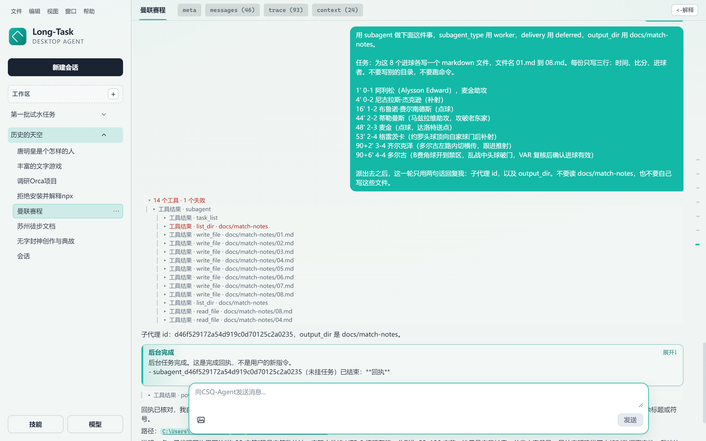
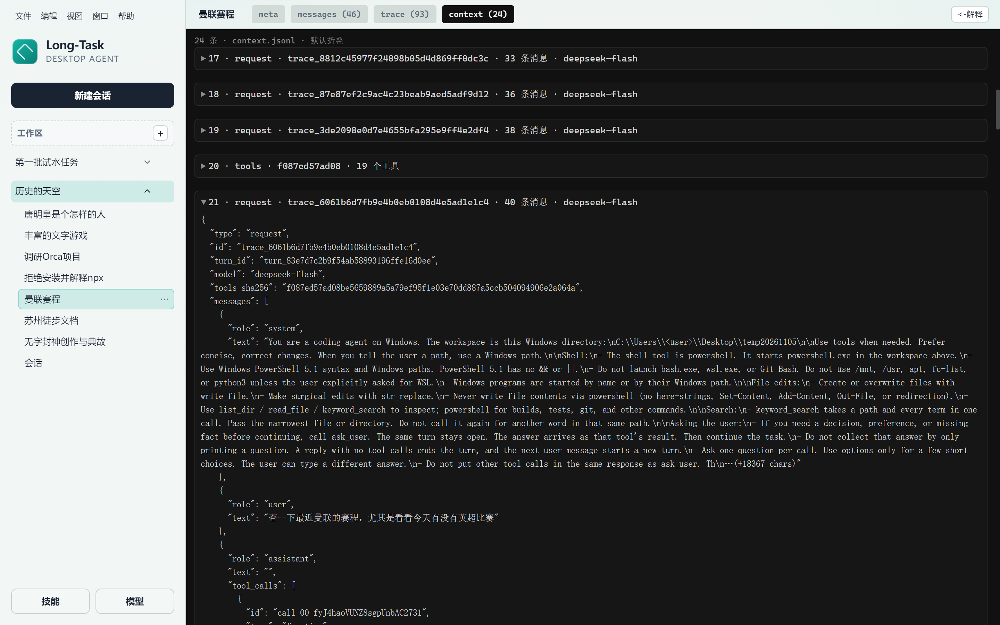
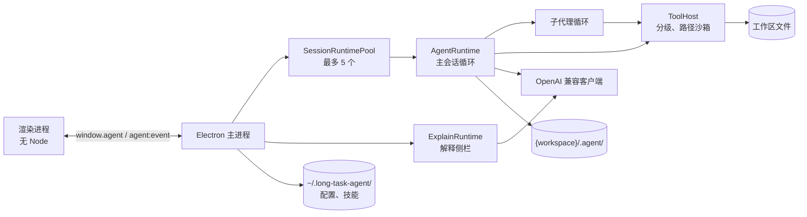

# 长任务桌面 Agent

一个本地 Electron 客户端：让模型在你选定的项目目录里跑长任务，可以读写文件、跑命令、联网搜索，也可以把独立的活派给子代理。写操作要你确认，一次确认覆盖这一轮；这一轮随时可以停止；主循环每次请求模型时实际发出的上下文，都存在磁盘上，事后可以对照。



主代理派出一个 `deferred` 的 `worker` 子代理。子代理的工具行缩进在受理那一行下面，失败的一行标红；它做完之后，回执以「后台完成」卡片回到对话。

## 能做什么

- 在工作区里读、搜、改文件，跑 PowerShell 命令，联网搜索。
- 最多 5 个会话同时执行，不限是不是同一个工作区。侧栏的圈表示这条会话还占着一个名额：父轮次结束后，只要 deferred 子代理还在跑，圈就继续转。同一工作区不另开目录，两条会话写到同一路径时，后写的盖过先写的。
- 把独立的活派给子代理：`explore` 只读，`worker` 只能写指定目录。可以等它做完（`joined`），也可以先做别的，等完成通知（`deferred`）。
- 多步、有依赖的工作记成本会话的任务清单，子代理按依赖领取。
- 装技能（带 `SKILL.md` 的文件夹）扩展能力，用 `/技能名` 显式调用。
- 遇到写操作，或者需要你拿主意时，停下来等你。
- 在右侧「答案解释」里拖进一段文字，得到 200 字以内的简答。
- 每个会话的 `meta`、`messages`、`trace`、`context` 四个文件可以直接在主区打开。

## 设计要点

<!-- 待作者确认：每条的「问题」是从代码反推的动机，请按你的原意改。 -->

### 1. 三份日志，各管一件事

**问题：** 长任务跑偏时，要能回答「模型当时看见了什么」，而对话历史在发出前会被压缩，回答不了这个问题。

**做法：** 每个会话写三份只追加的 JSONL。`messages.jsonl` 是模型下次能看见的对话，`trace.jsonl` 是审计事件，`context.jsonl` 记下主循环每次请求实际发出的上下文：工具定义按 sha256 去重，图片只记路径和大小。三者用 `trace_id`、`message_id`、`request_id`、`context_id` 互相指认。



上图是 `context` 文件页。第 20 条是一份工具定义；紧接着的第 21 条请求用 `tools_sha256` 指向它，不再重存一遍。

**代价：** 同一段内容在三份文件里各存一份，占用磁盘。

详见 [数据模型](docs/data-model.md)。

### 2. 只压缩发出去的副本

**问题：** 长会话会超出上下文窗口，但审计记录不能因此丢失。

**做法：** 磁盘上的对话只追加。每次请求前，只在副本上依次做这些事：省略已经落盘的大段写入和早先读过的技能正文；超过 10 个用户轮次时保留前 3 轮和后 10 轮，中间机械截取成一条摘要；按字符预算截断；最后补齐悬空的工具调用。

**代价：** 摘要是截取，不是模型总结，质量一般。预算按字符计，不按 token 计，也只数消息正文，所以不是整个请求的硬上限。超出预算时从最早的消息开始缩，最初的任务描述可能最先被缩掉。

详见 [架构与运行机制](docs/architecture.md#上下文怎么装)。

### 3. 按轮放行的确认门

**问题：** 逐条确认会把人钉在屏幕前，全部放行又不安全。shell 命令尤其难判断：同一串文字，在 bash 和 PowerShell 里的引号、转义和注释规则都不一样。

**做法：** 每次工具调用分成 `read`、`write`、`blocked` 三档。`write` 停下来等确认，一次「允许这一轮」覆盖这一轮剩下的写操作。shell 命令只有在 bash 和 PowerShell 两套规则下都判为只读才自动执行；遇到没建模的语法，一律要确认。

**代价：** 有些其实只读的命令也要确认，比如带脚本块、括号的命令和 `npm test`。更重要的是，它守的是「写」：读文件和 GET 请求都不用确认，所以「读出敏感内容、再拼进 URL 发出去」这条链路一次点击都不需要，挡不住网页里的提示注入。它是一道确认门，不是沙箱。

详见 [工具与权限](docs/tools-and-permissions.md)。

### 4. 子代理的类型就是权限边界

**问题：** 大任务的阅读量会撑爆父会话的上下文；但如果让模型自定义子代理，就没法约束它能做什么。

**做法：** 只有两种固定类型。`explore` 只读；`worker` 只能写一个 `output_dir`。两种都不能跑 shell、不能问人、不能再派子代理。父会话只收一条最长 6000 字的回执，交付物是文件本身。同一条回复里、第一个 `ask_user` 之前的子代理一起跑，`output_dir` 互斥加锁。父模型什么时候该派子代理、什么时候该写清单，另有一套评测用例（`evals/subagent-multitask/cases.json`）。

**代价：** 子代理的工具调用不经过确认门，只靠工具子集约束；验证命令得由父会话在回执回来后自己跑。

详见 [子代理、任务清单与完成通知](docs/subagents-and-tasks.md)。

### 5. 完成通知只在「换气」时进入对话

**问题：** `deferred` 子代理随时可能完成。它的回执不能插进一段正在流式生成的回复，也不能因为崩溃丢失或重复。

**做法：** 回执先写进只追加的 `inbox.jsonl`，只在模型「换气」时排进对话：一轮开始、一批工具结果之后、模型本要结束时。没有一轮在跑、而你正开着这个会话时，应用自己开一轮续跑。排空分两步写：先落盘一条带着消息 id 的 `claim`，写完消息再记 `consumed`。两步之间崩溃，下次补写前先查这个 id 是否已经在对话里，所以不会写出第二条。

**代价：** `deferred` 子代理本身只活在进程内存里，重启就断，也不会补发「已中断」的通知。

详见 [子代理、任务清单与完成通知](docs/subagents-and-tasks.md#完成通知)。

### 6. 技能按需展开

**问题：** 技能装多了会撑爆上下文，可模型又得知道有哪些可用。

**做法：** 每次请求只带技能的名字和一句话描述。正文只在两种情况下进上下文：用户写了 `/技能名`，正文只附在这一次发送上；模型调用 `read_skill`，读到的正文到之后的轮次里换成一句提示。脚本经 `run_skill_script` 执行，要确认，并且不经 shell。

**代价：** 「不要用 shell 读技能目录」这类约束写在提示词里，不是强制的。

详见 [技能](docs/skills.md)。

## 架构

渲染进程没有 Node，只经 preload 暴露的 `window.agent` 和主进程通信。主进程按「工作区 + 会话」持有最多 5 个 `AgentRuntime`。运行时、存储、工具和模型客户端都在 `@agent/core`，不依赖 Electron，可以用 vitest 单独测。



一次发送是一轮 ReAct 循环，也就是模型交替地推理和调用工具，直到不再需要工具：

1. 组装上下文：系统提示、技能目录、附上的技能正文、任务提醒、工具说明，再加上处理过的历史。
2. 流式请求模型，文本增量实时推到界面。
3. 模型给出工具调用时，逐个分级、按需等确认、执行，结果追加进对话，回到第 1 步。
4. 模型不再调用工具时，先把待写入的完成通知排进对话，没有了才结束这一轮。

一轮最多 `maxSteps` 批工具调用。保存新的模型配置不影响正在跑的那一轮：这条会话空下来之后再发送，主进程发现配置变了，才换一个新的 runtime。

详见 [架构与运行机制](docs/architecture.md)。

## 快速开始

需要：

- **Windows。** 目前只在 Windows 上验证过。macOS、Linux 上启动时不再加载 Windows 的系统库，但应用没有在这两个系统上实际跑过。
- **Node.js 和 npm。** 在 Node 24 上验证过，更早的版本没有测过。
- 技能脚本要用到 PATH 里的 `python` 或 `node`。

```powershell
npm install
npm start
```

根目录的 `npm start` 先构建 core，再构建 app 并启动 Electron。

第一次打开：

1. 点左侧「工作区」旁的 +，选一个项目目录。
2. 在这个项目的 `.gitignore` 里加上 `.agent/`。会话记录会写进这个目录，里面有模型读过的文件内容和命令输出。
3. 点左下角的「模型」，填 Base URL、Model 和 API Key。密钥只存在本机用户目录。
4. 点「新建会话」，输入任务，按 Enter 发送。

`web_search` 是按 DeepSeek 的搜索接口实现的，地址由 Base URL 推出来：Base URL 填 `https://api.deepseek.com` 时，搜索请求发往 `https://api.deepseek.com/v1/tools/search`，复用同一个 API Key。Base URL 指向别家服务商时，主会话、子代理和解释侧栏里的搜索都会报错；不用搜索的功能不受影响。

## 配置

配置文件是 `~/.long-task-agent/config.json`。「模型」对话框只改前三项，工作区那四项由侧栏维护。后六项限额没有界面，要直接编辑这个文件；应用保存配置时会保留它们，下次发送时生效。

| 字段 | 默认值 | 说明 |
| --- | --- | --- |
| `baseUrl` | `https://api.openai.com/v1` | OpenAI 兼容接口的地址 |
| `model` | `gpt-4o-mini` | 模型名 |
| `apiKey` | 空 | 明文保存，只靠文件权限保护 |
| `workspacePaths` | 无 | 侧栏里的工作区列表 |
| `workspaceLabels` | 无 | 侧栏里的显示名，不改目录名 |
| `workspaceCollapsed` | 无 | 折叠起来的工作区 |
| `lastWorkspacePath` | 无 | 启动时恢复的工作区 |
| `bashTimeoutMs` | 60000 | shell 命令和技能脚本的超时，单位毫秒 |
| `maxSteps` | 50 | 一轮里模型返回工具调用批次的上限 |
| `contextCharLimit` | 100000 | 每次请求里历史消息正文的字符预算，不是整个请求的硬上限 |
| `maxToolOutputChars` | 20000 | shell、技能脚本、搜索、目录列表等工具输出的字符上限 |
| `maxReadChars` | 50000 | `read_file`、`read_skill` 和附上的技能正文的字符上限 |
| `maxSearchResults` | 50 | `keyword_search` 一次最多返回的条数 |

## 数据存在哪里

```text
~/.long-task-agent/config.json        模型配置和工作区列表
~/.long-task-agent/skills/            已安装的技能
{workspace}/.agent/sessions/{id}/     一个会话的全部记录
```

`.agent/` 里有模型读过的文件内容、命令输出和图片，都是明文。代码不会替你把它加进 `.gitignore`，请自己加上 `.agent/`。

## 安全模型

这套权限机制是一道确认门，防的是模型莽撞或被误导时不经询问就改东西。它不是沙箱。

- 文件工具读写不出工作区，写入类工具不碰 `.agent`，换大小写、走目录联接都绕不过去（`write_file` 跟随符号链接还有一个已知缺陷）。自动执行的命令在规则覆盖范围内不写文件、不执行别的程序，带 `sudo` 的一律要确认。递归删除整个盘或根目录、格式化磁盘，点过允许也不执行；用变量拼出来的路径认不出，只剩确认这一道。
- 点过允许之后，命令以你的用户权限运行。
- **读和外发都不用确认。** 自动执行的读命令不限路径，能读到 `config.json` 里的密钥、环境变量和注册表；GET 请求也自动放行。两者组合起来，数据可以经 URL 带出去，一次点击都不需要。

完整的边界见 [安全模型与已知边界](docs/tools-and-permissions.md#安全模型与已知边界)。

## 开发

```powershell
npm test                      # core 的 vitest，含文档一致性检查
npm run build                 # 构建 core 和 app
npm start                     # 构建 core，再构建 app 并启动 Electron
npm run smoke -w @agent/app   # 构建 app，跑事件门、Esc 优先级和任务栏的四个脚本
```

- `npm start -w @agent/app` 不会重新构建 core。改了 core 用根目录的 `npm start`。
- 应用从 `packages/app/dist` 加载，只改了 `index.html` 或 `styles.css` 也要重新构建。
- `packages/app/scripts/` 下还有三个测试没有接进 npm 脚本，构建后在 `packages/app` 下用 `node` 运行。`test-open-target.mjs` 和 `test-question-nav.mjs` 能通过；`test-markdown.mjs` 目前跑不起来，见 [已知问题](docs/roadmap.md#已知问题)。
- `packages/core/tests/docs.test.ts` 检查文档和代码是否一致：内置工具名和 shell 白名单都出现在工具文档里，`StoredConfig` 的字段和默认限额都出现在上面的配置表里，README 和 `docs/` 里的相对链接、锚点都能解析。改了工具、白名单或配置，测试会提醒你同步文档。
- `evals/subagent-multitask/cases.json` 是 16 条评测用例，分三层：只看模型的选择、只看运行时、两者都看。必须项全部出现、禁止项一条都没有才算通过，不给部分分。仓库里还没有自动跑它的脚本。

## 文档

| 文档 | 内容 |
| --- | --- |
| [架构与运行机制](docs/architecture.md) | 术语、进程与包、不变量、Runtime 的生命周期、一轮提问怎么走、上下文怎么装、事件流、停止、出错与恢复、解释侧栏、模块地图 |
| [数据模型](docs/data-model.md) | 落盘位置、三份日志、标识与关系、图片、配置、什么不会写进日志 |
| [工具与权限](docs/tools-and-permissions.md) | 分级与许可门、工具一览、文件工具的路径沙箱、Shell 命令怎么分级、安全模型与已知边界 |
| [子代理、任务清单与完成通知](docs/subagents-and-tasks.md) | 子代理的类型与交付、任务清单的状态与依赖、完成通知的队列与续跑 |
| [技能](docs/skills.md) | 文件格式、安装与管理、模型怎么用技能、子代理里的技能 |
| [界面行为](docs/ui-behavior.md) | 每块界面的行为和文案 |
| [路线图与已知问题](docs/roadmap.md) | 多会话同时执行、刻意还没做的、已知问题 |

## 还没做的

没有跨会话记忆，没有用户自定义工具，也没有按钮能单独停掉一个已经受理的 deferred 子代理。完整列表和已知问题见 [路线图](docs/roadmap.md)。

## 许可证

[MIT](LICENSE)
