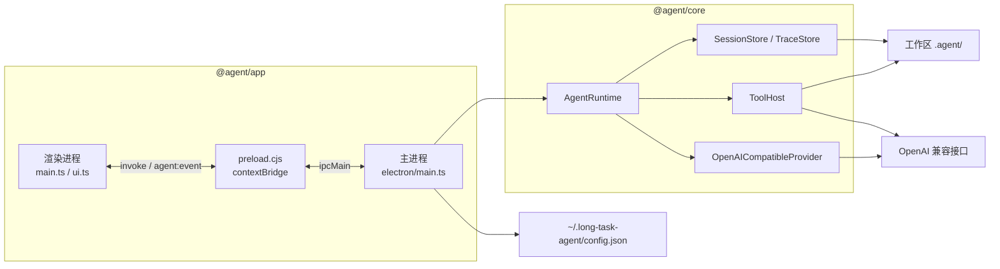

# 长任务桌面 Agent

本仓库是一个本地 Electron 客户端。它在用户选定的工作区里跑可中断的 ReAct：向 OpenAI 兼容接口流式要模型输出，按模型给出的工具调用去读改文件、跑命令或搜索，并把对话与审计分开落在工作区里。换工作区不会串历史。密钥只留在本机用户目录。

界面是一块独占的主区：会话页，加上 `meta.json`、`messages.jsonl`、`trace.jsonl`、`context.jsonl` 四个文件页，各占整页。输入框浮在内容上，不占一条横贯的底栏。

## 系统架构

渲染进程没有 Node。它只通过 preload 上的 `window.agent` 说话。主进程持有当前工作区上唯一的 `AgentRuntime`。运行时、存储、工具和模型客户端都在 `@agent/core`，不依赖 Electron，可以用 vitest 单独测。



约束：

- 侧边栏可以记下多个工作区，点 + 是增加，不会换掉已有的那一条。点工作区名字或旁边的箭头，只展开或折叠该目录的会话，不换掉右侧正在看的页面。点开某个会话才会显示它。任务进行中仍可点开别的会话查看，发送和输入都是灰色，不能打字。那一页的输入框里用绿色写「另一个会话正在执行」，不把正在跑的阶段提示带到这一页。停止和「等待确认权限」这类实时状态只在正在执行的那个会话页上。左侧该会话标题前有一枚发送按钮同色的转圈；工作区若被折叠，转圈改标在工作区名字前。工作区的展开和折叠记在本机配置里，重启后保持。输入框跟页面绑定：新建会话页和每个会话各留自己的草稿，切走再切回来还在，不会带到别的会话里。同一时刻只有一个 `AgentRuntime`。
- 一个 runtime 同时只跑一轮 `submit`。再提交会得到 `busy`。正在执行的那一页，发送按钮变成「停止」；其他会话页的发送保持灰色，不能从那一页停止。停止走 `cancel()`。
- 主进程打开窗口时打开 `contextIsolation`，关闭 `nodeIntegration`，并拒绝页面内导航和新窗口。preload 必须编成 CommonJS（`preload.cjs`），沙箱里不能用 ESM。
- 应用从 `packages/app/dist` 启动。改了渲染层的 TypeScript 要重新 `build`；只改 `index.html` 或 `styles.css` 时，构建末尾的静态拷贝会把它们抄进 dist。

## 保存模型配置

在「配置模型」里保存，只把 Base URL、模型和密钥写入 `~/.long-task-agent/config.json`，不拆掉正在跑的任务。权限确认和「等你回答」继续挂在原来的 runtime 上。这一轮里后面的每次模型调用，仍用这一轮开始时的地址、模型和密钥。一次发送里面可以有多次模型调用，这些调用不会中途换配置。

下一次点发送时，若磁盘上的配置和当前 runtime 不一致，才丢掉旧对象，按新配置再建一个。模型和供应商是创建 runtime 时定下来的，所以生效方式是换一个新对象，不是在正在跑的对象上改字段。正在跑的时候再发送会得到 `busy`，不会趁这次发送把 runtime 换掉。停止仍然作用在这一轮的 runtime 上。

换工作区仍会换掉 runtime。会话目录和工具的工作区路径绑在这个对象上，和模型配置不是同一件事。

### `@agent/core`

| 模块 | 职责 |
| --- | --- |
| `runtime/agentRuntime.ts` | 一轮对话的状态机：落库、组装上下文、流式调用、按序执行工具、取消、自动标题 |
| `runtime/permission.ts` | 写操作的许可门。Electron 用 `DeferredPermissionGate`，测试可用 `AutoAllowGate` |
| `provider/openaiCompatible.ts` | 把组装好的消息打成 chat-completions 流，解析文本、工具调用和 token 用量 |
| `context/assemble.ts` | 发给模型的顺序：system（含工具说明）→ 压缩后的历史 → 当前用户消息 |
| `context/compress.ts` | 只压缩「这一次发给模型的副本」。用户轮次超过 10 时保留前 3 轮和后 10 轮，中间收成摘要，再按字符上限截断。磁盘上的 jsonl 不动 |
| `context/repairToolCalls.ts` | 崩溃或取消后，给没有结果的 `tool_call` 补一条合成 tool 消息，避免下次请求因不成对而失败 |
| `store/sessionStore.ts` | 会话目录、`meta.json`、`messages.jsonl` |
| `store/traceStore.ts` | 只追加的 `trace.jsonl` |
| `tools/host.ts` | 内置工具表。未知工具和参数解析错误都变成 `is_error` 的工具结果，不抛出循环 |
| `tools/policy.ts` | 把一次调用分成 `read` / `write` / `blocked` |
| `tools/fsSandbox.ts`、`pathSandbox.ts` | 文件类工具的路径必须落在工作区内 |
| `config/loadConfig.ts` | 读写用户目录里的配置。POSIX 上目录 `0700`、文件 `0600`；Windows 上 chmod 失败会被忽略 |
| `session/autoTitle.ts` | 标题仍是默认值、且不是用户手改时，用本轮内容起一个标题 |

### `@agent/app`

| 模块 | 职责 |
| --- | --- |
| `electron/main.ts` | 窗口、中文菜单、工作区对话框、IPC、把 `RuntimeEvent` 转成 `agent:event`。也记住上次工作区路径。系统菜单不占通栏，收在侧栏里弹出 |
| `electron/preload.ts` | 唯一暴露给页面的 API：`window.agent` |
| `electron/openTarget.ts` | 打开外链。页面不能自己导航 |
| `src/renderer/main.ts` | 工作区与会话列表、会话页和四个文件页的切换、订阅事件、发送/停止、页内搜索 |
| `src/renderer/ui.ts` | 消息气泡、Markdown、工具条、来源块、空状态。不持有会话状态 |
| `src/renderer/runEventGate.ts` | 进行中的事件若不属于当前正在看的会话或轮次，就不往界面上画。`done` 仍会清掉这轮的门闩 |

渲染层三个文件的边界：`main.ts` 决定「现在看哪一页、这轮算不算当前会话」；`ui.ts` 只负责把一块内容画成 DOM；`runEventGate.ts` 是纯函数，用来丢掉过期事件。

## 数据关系

两套落盘，互不写入。

```text
~/.long-task-agent/config.json          密钥、Base URL、模型、上次工作区、可选限额
{workspace}/.agent/sessions/{sessionId}/
  meta.json                             会话身份
  messages.jsonl                        发给模型的对话，一行一条 Message。图片只记相对路径；再次组请求时只有最新一条用户消息上的图片会变成像素
  images/                               用户随提示词上传的图片字节
  trace.jsonl                           审计索引，一行一条 TraceEvent。llm_request 用 context_id 指向 context.jsonl
  context.jsonl                         每次模型调用看见的上下文。图片只记路径和字节数，工具表全文只在哈希首次出现时写一行
```

`sessionId` 只能是一段路径名（字母、数字、下划线和连字符），避免被拼进目录时逃出 `.agent/sessions/`。

```mermaid
flowchart TB
  meta["SessionMeta<br/>session_id, workspace_path, title, title_source"]
  msg["Message<br/>id, turn_id, role, trace_id"]
  trace["TraceEvent<br/>id, turn_id, message_id, request_id"]
  call["assistant.tool_calls[]"]
  toolmsg["role=tool 的 Message<br/>tool_call_id"]

  meta -->|"1 对多"| msg
  meta -->|"1 对多"| trace
  msg -->|"同一 turn_id"| msg
  msg -->|"trace_id = TraceEvent.id"| trace
  trace -->|"message_id = Message.id"| msg
  trace -->|"request_id 指回 llm_request"| trace
  call -->|"id = tool_call_id"| toolmsg
```

一条用户消息打开一个 `turn_id`。这一轮里的助手文本、工具调用和工具结果都带同一个 `turn_id`。`messages` 是模型下一次能看见的历史；`trace` 是同一次动作的审计。两边用 `trace_id` / `message_id` 互指。`llm_response` 和 `llm_error` 再用 `request_id` 指回对应的 `llm_request`。每一条 `tool_result` 同样用 `request_id` 指回它的 `tool_call`。

`role=tool` 的消息可以带 `tool_call_arguments`，只给界面和审计看。组装上下文时不会把它再发给模型，因为参数已经在配对的那条助手消息的 `tool_calls` 上。

标识前缀：`sess`、`turn`、`msg`、`trace`、`perm`。

配置里的 `apiKey` 不会出现在 messages、trace 或 context 里。`llm_request` 只记模型名、条数、字数、图片张数和 `context_id`。这个 id 就是 `context.jsonl` 里对应请求行的 `id`，文件字段名不改。四个文件页里，`messages.jsonl`、`trace.jsonl`、`context.jsonl` 都按条折叠：标题是序号、角色或事件类型，再加一行摘要；展开后是这一条的 JSON，超过 1600 字的字符串截断。`meta.json` 是整份 JSON。用当前页搜索 `context_id` 即可定位。`user_message` 这条 trace 只记字数，不记正文。

## 一轮提问

1. 渲染进程 `submit(sessionId, text)`。主进程交给当前 runtime。
2. 先补齐磁盘上悬空的工具调用，再追加 `turn_start`、用户 `Message` 和 `user_message` trace。
3. 循环直到没有工具调用、被取消、出错或到达 `maxSteps`（默认 50）：
   - 读出全部 messages，压缩副本，装成上下文。
   - 流式请求模型。文本增量以 `text` 事件推到界面；工具调用以 `tool_call` 事件推送。
   - 没有工具调用就 `done(completed)`，并视情况自动改标题。
   - 有工具调用则 `steps` 加一。本批调用按顺序执行，不是并行。
4. 每个工具先经 `classifyToolCall`：
   - `read`：直接执行。
   - `write`：发出 `permission_request`，等界面允许或拒绝。允许一次即放行这一轮剩下的写操作和命令；拒绝只否定这一次，写成一条错误工具结果，循环可以继续。`ask_user` 不在这次放行里。
   - `blocked`：不执行，写成错误工具结果。上一轮的允许也不会把这类命令放出来。
5. 每条工具调用先写一条 `tool_call` trace（工具名、参数）。真正执行的记在开跑之前；拒绝、停止、未执行而收口的记在结果前面，两条时间会贴在一起。然后追加 `role=tool` 的消息和 `tool_result`。`tool_result.request_id` 指回这条 `tool_call`。拒绝、停止写在结果的 `denied` / `cancelled` 上，不写进开始记录。`duration_ms` 只出现在真正执行过的结果上，不算等你点允许的时间。然后回到第 3 步，让模型看见结果。
6. 取消会留下已经流出的文本（标成 interrupted），停掉正在跑的 shell，尚未执行的工具调用用合成结果收口，并写 cancel trace。

`maxSteps` 数的是「模型返回了一批工具调用」的次数，不是单次 HTTP。一批里有三次 `web_search`，这一轮只把 `steps` 加一，但会打出三次搜索请求，外加这一轮的对话补全请求。搜索和 token 是两笔用量。

## 工具

| 工具 | 风险 | 说明 |
| --- | --- | --- |
| `read_file`、`list_dir`、`keyword_search` | 自动放行 | 路径限制在工作区内。读和搜索有字符与条数上限 |
| `web_search` | 自动放行 | 一次调用向 `{llmBase}/v1/tools/search` 发一个 POST。`count` 默认 8、最大 50。`need_content` 为 false，返回的是摘要不是整页。查询最长 128 字 |
| `ask_user` | 停下来问人 | 同一轮挂起，直到用户回答。回答写成这条工具调用的结果，然后模型继续。同一条回复里排在它后面的工具不会执行。只把问题打印出来、不调用这个工具，会结束这一轮 |
| `write_file`、`str_replace`、`delete_file` | 这一轮确认一次 | 路径同样不能逃出工作区。点「允许这一轮」后，同一次发送里后面的写操作不再逐条询问 |
| `powershell`（Windows）/ `bash`（其他系统） | 看命令 | Windows 上启动 `powershell.exe`，工作目录是 Windows 路径。只读命令，以及不落盘的 `curl` / `Invoke-WebRequest` / `Invoke-RestMethod`（不是 POST、PUT、DELETE、PATCH，也没有 `-OutFile`、`-o`）自动放行。其余需确认，允许一次覆盖这一轮剩下的命令。清空磁盘根目录仍直接拦截。超时默认 60 秒，输出会截断。旧会话里的 `bash` 调用会返回错误，不再进入 WSL |
| 未知工具 | 需确认 | 分类上按写操作对待；宿主找不到实现时返回错误结果 |

界面上每个工具条按 `tool_call.id` 和后来的 `tool_result.tool_call_id` 配对。同名工具不会合并：合并会藏掉不同的查询，也不能少计一次已经发出的请求。


*deepseek阅读工具系统代码后的亮点总结：*

> # **AI Agent 工具系统（Tool System）设计亮点**
>
> 本项目的工具系统（`src/tools/`）不仅是 LLM 与本地系统交互的“双手”，更是一套兼顾高扩展性、强安全性以及工业级健壮性的底层基建。
>
> ## **一、 核心架构与接口设计**
>
> ### **1.** `types.ts` **- 严谨的接口契约**
>
> - **环境与展示分离**：`ToolDefinition` 纯粹用于给大模型看（序列化后作为 function calling 的 schema 注入 Prompt）；而 `ToolContext` 纯粹给本地运行时看（携带绝对路径、超时限制、API Key、中断信号等敏感/环境信息），绝不泄露给 LLM。
> - **标准化输出**：强制所有工具返回 `{ content: string, is_error: boolean }`，保证 LLM 能统一理解执行结果是成功还是失败。
>
> ### **2.** `host.ts` **- 控制反转的调度枢纽**
>
> - **注册与分发**：作为 Tool 的“大管家”，屏蔽了上层业务对具体工具的感知，通过 `Map` 统一管理工具的注册与执行。
> - **异常兜底**：在 `execute` 入口处严格捕获 `JSON.parse` 解析错误和工具内部的运行时异常，防止 LLM 发癫传入错误参数导致整个 Node 进程崩溃。
>
> ## **二、 顶尖的安全防御机制（Security & Sandbox）**
>
> ### **3.** `fsSandbox.ts` **- 绝对防御的路径沙箱**
>
> - **防路径穿越与软链接逃逸**：全面使用 `realpath` 解析文件的真实物理路径，并通过 `isPathInside` 严格校验，杜绝 AI 越权访问工作区外部的系统文件。
> - **防深层溯源漏洞**：在创建（写入）未知的深层目录时，采用**“向上溯源”**策略。通过 `access` 找到第一个真实存在的父目录，确权后才逐层 `mkdir`，并在写入后再次复核，完美防御 TOCTOU（竞争条件）攻击。
>
> ### **4.** `dangerous.ts` **&** `policy.ts` **- 分级拦截与安检门**
>
> - **危险操作黑名单**：`dangerous.ts` 直接用正则一票否决高危命令（如 `mkfs`、针对根目录的 `rm -rf /`、底层 `dd` 写入等）。
> - **读写分级与 Human-in-the-loop**：`policy.ts` 对 Bash 命令进行语法级别的深度解析（剥离引号、拆分管道、识别重定向 `>`）。将行为分为 `read`（直接放行）、`write`（触发用户弹窗确认）和 `blocked`（直接拦截），在用户体验与安全性之间找到完美平衡。
>
> ## **三、 工业级的运行时健壮性（Robustness）**
>
> ### **5.** `bash.ts` **- 全副武装的执行器**
>
> - **跨平台进程树击杀**：专门针对 Windows 平台使用 `taskkill /T /F`，同步强杀子进程树，解决 Git-Bash 等环境下孤儿进程占用文件（EBUSY）的痛点。
> - **流式内存截断（防 OOM）**：在 `stdout`/`stderr` 接收数据块（Chunk）时实时累加长度。一旦超出 `maxToolOutputChars` 预算，立即强杀进程并返回截断数据，防止 `cat` 大文件导致 Node.js 内存溢出。
> - **命令长度限制**：禁止 AI 使用 Bash 的 `echo/heredoc` 写入大文件，强制其使用专用的文件工具。
>
> ### **6.** `listDir.ts` **- 带过滤器的目录扫描**
>
> - **防 Token 爆炸**：强制硬编码跳过 `node_modules`、`.git`、`.agent` 等黑洞目录。
> - **容错与跨平台**：遍历时忽略无权访问或损坏的死链接，并强制统一路径分隔符（`\` 转 `/`），保证不同操作系统下输出格式的一致性。
>
> ### **7.** `strReplace.ts` **- 精准的代码微雕刀**
>
> - **唯一性校验防呆**：默认执行单次替换，如果 `old_string` 在文件中出现多次，则报错拒绝执行。强制 AI 提供更丰富的上下文以保证唯一性（或显式传 `replace_all: true`），避免“误伤”其他代码。
>
> ### **8.** `deleteFile.ts` **- 受控的文件粉碎机**
>
> - **拒绝目录删除**：通过 `stat` 二次校验，仅允许删除具体文件，拒绝目录删除操作，防止 AI 一键抹除项目源码。
>
> ### **9.** `readFile.ts` **- 带限流阀的阅读器**
>
> - **读取截断保护**：内置 `maxReadChars` 限流保护，防止 AI 读取超大文件（如编译产物或日志）直接击穿 LLM 的 Token 限制。
>
> ### **10.** `search.ts` **- 高效的关键词嗅探器**
>
> - **大文件跳过**：在遍历检索时，利用 `stat` 检查文件大小，直接跳过超过 1MB 的巨型文件，保证检索性能。
>
> ### **11.** `webSearch.ts` **- 连接真实世界的顺风耳**
>
> - **输入与输出净化**：严格限制查询词长度（128 字符），针对 API 返回的杂乱 JSON，格式化为带序号的 Markdown 链接和摘要，极大降低 LLM 的解析负担，并引导其规范引用来源。
>
> ---
>
> **💡 架构总结：**  
> 本工具系统遵循了**“把 LLM 当作聪明的盲人”**的设计哲学：对外提供极简且安全的接口，对内做好极端的防呆（防崩溃、防越权、防爆内存）。任何工具只需实现 `Tool` 接口，即可无缝接入 Agent 的武器库。

## 界面

主区四个标签互斥，点哪一个就只显示那一页。侧栏换会话时回到「会话」页，并直接跳到对话底部，不做平滑滚动。

`Ctrl+F` 只搜当前这一页，按大小写不敏感的原文包含来比，不用正则。高亮用 CSS Highlight API，不改写 Markdown 的 DOM。对话页搜气泡和工具结果；四个文件页搜各自的 JSON。换页会沿用关键字，并从该页第一处重新数。被链接或加粗从中间切开的词对不上，因为比对是按可见文本节点做的。

输入框是浮在主区底部的白卡片，不占文档流。对话和文件视图铺满到窗口底，滚动区底部留出与卡片等高的空白，避免最后一行被挡住。确认写操作的卡片叠在输入框上方，同样不铺一条底栏。

会话行的「⋯」菜单挂到 `document.body`，避免被侧栏的滚动容器裁切。侧栏本身不滚动；会话多出来时只滚列表，且不画滚动条。点开菜单的那一行会铺上和当前会话相同的绿色，菜单关闭后褪去。当前会话的绿色仍然保留，所以两行可以同时是绿的：一行表示正在看，一行表示菜单目标。

## 开发

```bash
cd long-task-desktop-agent
npm install
npm run test -w @agent/core
npm run build -w @agent/core
npm start -w @agent/app
```

`npm start` 会先构建 core 再启动 Electron。改了界面后需要重新构建再打开应用，否则窗口仍加载上一份 dist。

## 现在还不做

没有跨会话记忆，没有用户自定义工具，没有子 Agent，也没有右侧检视面板。文件页就是主区里的四个标签，不是分栏。

旧说明里写过「不做 web」。这已经不对：`web_search` 是内置工具。
