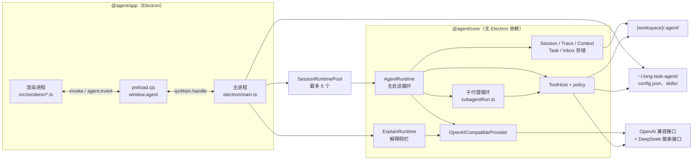

# 架构与运行机制

应用分两个进程、两个包。渲染进程只负责画界面，没有 Node；主进程用 `SessionRuntimePool` 按「工作区 + 会话」持有最多 5 个 `AgentRuntime`。运行时、存储、工具和模型客户端都在 `@agent/core`，不依赖 Electron，可以用 vitest 单独测。

一次发送就是一轮 ReAct 循环，也就是模型交替地推理和调用工具：装上下文，流式请求一个 OpenAI 兼容接口，执行模型给出的工具调用，再请求，直到模型不再调用工具。每一步写三份记录：模型下次能看见的对话、审计用的事件、每次请求实际发出的上下文。

## 术语

| 词 | 意思 |
| --- | --- |
| 轮（turn） | 一次发送带起的整段模型循环，有一个 `turn_id`。「允许这一轮」「停止这一轮」都指它 |
| 用户轮次 | 含有用户消息的一个 `turn_id`。压缩按它计数，只有回执的续跑轮也算一个；自动标题不算续跑轮 |
| 批 | 模型一次回复里的一组工具调用 |
| 步 | `maxSteps` 的计数单位，一批算一步 |
| 回合 | 子代理里的「步」，上限是 8 或 16，父会话的 `maxSteps` 更小时取更小的 |
| 续跑轮 | 完成通知开出的一轮，不是你发送的 |

## 进程与包

## 不变量

这些约束是其余设计的前提，改动时先检查它们：

- **渲染进程没有 Node。** 窗口开着 `contextIsolation`、关着 `nodeIntegration`，页面内导航和新窗口一律拒绝。页面只经 preload 暴露的 `window.agent` 说话。preload 必须是 CommonJS：tsc 先输出 `preload.js`，构建脚本再拷成 `preload.cjs`。
- **core 不依赖 Electron。** 许可和提问都是接口（`PermissionGate`、`AskGate`）。Electron 里接的是等界面回答的 `DeferredPermissionGate`、`DeferredAskGate`，测试里可以接 `AutoAllowGate`。
- **一个 runtime 对象同时只跑一轮。** 正在跑时再向同一条会话发送，得到 `busy`。续跑轮例外：第一条发送先暂存，排在回执后面，第二条才是 `busy`。不同会话各用各的对象，同时最多 5 个。
- **磁盘上的对话只追加，已有的行不改。** 压缩和省略只作用在这一次请求的副本上。悬空的工具调用有两道补齐：一轮开始、续跑和停止时，往 `messages.jsonl` 追加合成的 tool 消息；组请求时，再在副本上补一次。
- **一轮内不换模型配置。** 一轮开始时定下 Base URL、模型和密钥，这一轮里后面的每次模型调用都用这一份。

## Runtime 的生命周期

每个 `AgentRuntime` 在构造时绑定一个工作区。会话目录、沙箱和 shell 的工作目录都随这个对象定下来。同一工作区可以同时有多个对象，各管一条正在执行的会话；换工作区不再拆掉其他会话的对象。

在「配置模型」对话框（左下角的「模型」按钮）里保存，只重写 `~/.long-task-agent/config.json`，不碰正在跑的 runtime：权限确认和「等你回答」继续挂在原对象上。下一次点发送时，主进程比较 9 个字段：Base URL、模型、密钥，加 6 项限额。有变化、且这一条既没有轮次在跑、也没有后台子代理，才丢掉旧对象，按新配置再建。模型和供应商是建对象时定的，所以生效方式是换对象，不是在跑着的对象上改字段。

<!-- 待作者确认：选择「换对象」而不是热更新字段，是为了让一轮内的配置天然不可变、不需要加锁。 -->

解释侧栏用另一个对象 `ExplainRuntime`，全局一份，按「工作区 + 配置」复用。它和主会话可以同时跑，见 [解释侧栏](#解释侧栏)。

## 一轮提问怎么走

1. 渲染进程调用 `submit(sessionId, text, images, workspace)`，主进程交给这条会话自己的 runtime；还没有对象、且未满 5 个时才新建。用户消息里的 `/技能名` 会把那个技能的正文附进这一轮；技能不存在或已停用时，这次提交直接被拒，什么都不写。
2. 先补齐磁盘上悬空的工具调用，再追加 `turn_start`。若完成通知队列里有没写进对话的回执，先收成一条 `task-notification` 用户消息，再写你的这条消息。回执因此排在你这句话前面。
3. 循环，直到没有工具调用、被取消、出错，或到达 `maxSteps`（默认 50）：
   - 读出全部消息，按下一节的规则装成上下文，流式请求模型。文本增量以 `text` 事件推到界面。
   - 没有工具调用时，先排空完成通知。写出了回执就再请求一次模型，不结束这一轮；队列空了才发 `done`。
   - 有工具调用则 `steps` 加一。`maxSteps` 数的是「模型返回了一批工具调用」的次数，不是 HTTP 请求数。
4. 一批工具调用里，第一个 `ask_user` 之前的所有 `subagent` 用 `Promise.all` 一起跑，其余工具按顺序执行。普通工具先过 `classifyToolCall`，见 [工具与权限](tools-and-permissions.md)；`ask_user` 直接进入提问流程；`subagent` 由 runtime 自己判断：`worker` 要确认，`explore` 直接启动。
5. 每次工具调用写一条 `tool_call` 事件，执行后追加 `role=tool` 的消息和 `tool_result` 事件，后者用 `request_id` 指回前者。这一批结果都写完，先排空完成通知，再回到第 3 步。
6. 已经执行了 `maxSteps` 批之后，模型再返回的那一批不执行：每个调用写成合成结果 `Skipped: reached max tool steps (N)…`，再追加一条助手提示，然后 `done(max_steps)`。默认值 50 的意思是前 50 批照常执行，第 51 批被跳过。
7. 满 3 个用户轮次（不算只有回执的续跑轮）、标题还是默认值时，取会话里前 10 条有正文的用户和助手消息、每条前 240 字，请求模型起一个标题，最多 12 个字，只起一次。用户手改过的标题不动。

一批里有三次 `web_search`，`steps` 只加一，但会打出三次搜索请求，外加这一轮的对话补全请求。搜索和 token 是两笔用量。

## 上下文怎么装

`assembleContext`（`packages/core/src/context/assemble.ts`）组出这一次请求。主会话、子代理、解释侧栏三套循环共用它。

**system 的顺序：** 系统提示 → 已安装技能目录和技能使用规则 → 这一轮附上的技能正文 → 任务提醒 → `# Tools` 工具说明。工具定义同时作为 API 的 `tools` 参数发送，所以每次请求里有两份。

<!-- 待作者确认：system 里重复一份工具说明是有意的吗？若是为了兼容不认 tools 参数的网关，值得写一句；否则可以去掉，省下每次请求的字符预算。 -->

**历史的处理，全部只在发出去的副本上做，按这个顺序：**

| 步骤 | 规则 |
| --- | --- |
| 省略已落盘的写入 | 成功的 `write_file` / `str_replace` 参数超过 500 字时，只留路径和字数 |
| 省略早先读过的技能 | 之前用户轮次里 `read_skill` 的结果换成「此前读过技能 X 的正文。需要时再调用 read_skill。」 |
| 压缩 | 只看最后一条消息之前的历史。超过 10 个用户轮次时保留前 3 轮和后 10 轮，中间每条截成前 200 字，拼成一条以 `[summary of omitted turns]` 开头的用户消息，最长 4000 字。所以第 14 个用户轮次的第一次请求还没有摘要，这一轮调过工具之后的请求、或者第 15 个用户轮次才有 |
| 字数上限 | 预算 = `contextCharLimit` − system 长度 − 最后一条消息长度 − 100，至少 1000。只数各条消息的正文，不数 `tool_calls` 里的参数。先缩摘要，再从最早的消息往后缩；最后一条消息从不截断 |
| 补齐 | 没有结果的工具调用补一条合成的 tool 消息，避免请求因调用和结果不成对而失败。补出来的消息不计入预算 |

所以 `contextCharLimit` 是历史正文的预算，不是整个请求的硬上限：system、最后一条消息、工具参数和补齐出来的消息都可能让实际请求超过它。

摘要是机械截取，不另调模型。这样压缩不花钱、不增加延迟、结果可预测，代价是摘要质量一般。

<!-- 待作者确认：选机械摘要而不是 LLM 摘要的理由，上面是推测。 -->

**图片：** 消息里只记图片的相对路径。组请求时，只有最后一条用户消息上的图片会变成像素，以 base64 data URL 发出。

## 事件流

runtime 把 `RuntimeEvent` 交给主进程。不少事件本身不带 `session_id`，主进程在转发成 `agent:event` 之前补上这条会话的 `session_id` 和 `workspace`，界面才分得清该画到哪一页。事件类型：

| 类型 | 用途 |
| --- | --- |
| `text` | 助手文本增量 |
| `tool_call`、`tool_result` | 工具条的开始和结果；子代理的事件带 `parent_tool_call_id` 和 `session_id` |
| `permission_request`、`ask_user` | 等人；带 `request_id`，界面回答时原样带回。这是等人的配对号，和 trace 里指回前一事件的 `request_id` 不是一回事 |
| `status` | 当前阶段：`assembling`、`llm`、`tool`、`awaiting_permission`、`awaiting_user` |
| `done` | 一轮结束：`completed`、`max_steps`、`cancelled`、`error` |
| `error` | 出错说明 |
| `session_title` | 自动标题 |
| `inbox_wake`、`task_notification`、`held_user` | 完成通知开出续跑轮、写入回执、续跑期间暂存的用户消息 |

每条正在执行的会话有自己的 `runEventGate.ts` 状态。这个纯函数决定事件属不属于这一轮：你正看着这条会话就画在主区，否则画进它缓存着的对话节点。子代理的工具行在父轮次结束后也按这个会话归属。这个函数有单独的测试脚本 `packages/app/scripts/test-run-event-gate.mjs`。

## 停止

点「停止」时，主进程只处理这一条会话：挂起的权限请求按拒绝处理、提问取消，再调用这个对象的 `cancel()`。已经流出的文本保留，标成 interrupted。正在跑的 shell 被结束，Windows 上用 `taskkill /T /F` 连子进程一起结束。尚未执行的工具调用用合成结果收口，并写 `cancel` 事件。按钮变成灰色的「正在停止」，直到这个 runtime 发出 `done`。别的会话不受影响。

已经受理的 `deferred` 子代理不会被停止取消；删除它所在的会话才会中止它，见 [子代理、任务清单与完成通知](subagents-and-tasks.md#停止)。

## 出错与恢复

- **模型请求失败**（密钥错、限流、上下文超长、断网）：写一条 `llm_error` 事件，界面显示错误，这一轮以 `done(error)` 结束。不自动重试。已经写进对话的内容都在，下一次发送从这里接着来。
- **工具出错**：变成一条 `is_error` 的工具结果交还模型，这一轮继续。子代理里调用 `subagent` 或 `ask_user` 是例外，见 [已知问题](roadmap.md#已知问题)。
- **写磁盘失败**：这一轮以 `done(error)` 结束，然后尽力补齐悬空的工具调用；补不上的，下一次发送开头再补。
- **应用重启后**：会话、任务清单和完成通知队列都在磁盘上，下一次发送时先补齐悬空的工具调用。正在跑的那一轮断了，不会自动接着跑。`deferred` 子代理也断了：它的 meta 停在 `running`，它领取的任务停在 `in_progress`，不会补发通知；它占用的 `output_dir` 锁只存在内存里，随进程一起消失。
- **重新加载页面**：当时正在执行的对象全部取消，后台子代理也停掉。磁盘上的会话还在，这一轮不会接着跑。

## 解释侧栏

右侧「答案解释」是一个简答助手：把会话里选中的一段文字拖进去，或右键选「解释」，它用 200 字以内作答，必要时调用 `web_search`，最多列 3 条来源。

它由 `ExplainRuntime` 驱动，和主会话分开：

- 自己的循环，唯一的工具是改写过说明的 `web_search`，不读技能，也不读任务提醒。
- 从会话页拖出时，附上选区所在那一轮的用户正文和助手正文，每侧最多 4000 字（选区本身更长时整段保留），不带工具结果。
- 每个主会话一份解释记录，存在会话目录下的 `explain-*.jsonl`，重启后还在。
- 同一时刻全局只跑一个解释，可以和主会话同时进行。

## 模块地图

### `@agent/core`（`packages/core/src`）

| 模块 | 职责 |
| --- | --- |
| `runtime/agentRuntime.ts` | 主会话的状态机：落库、组上下文、流式调用、执行工具、许可、取消、完成通知、自动标题。一个对象一轮 |
| `runtime/sessionRuntimePool.ts` | 按工作区和会话持有这些对象，同时最多 5 个 |
| `runtime/subagentRun.ts` | 一个子代理的独立循环。自己的上下文，回给父会话的只有一条回执 |
| `runtime/explainRuntime.ts` | 解释侧栏的循环 |
| `runtime/permission.ts`、`runtime/askGate.ts` | 许可门和提问门的接口与实现 |
| `context/assemble.ts`、`compress.ts`、`repairToolCalls.ts`、`images.ts`、`taskReminder.ts` | 组上下文，规则见上文 |
| `provider/openaiCompatible.ts` | 把上下文打成 chat-completions 流，解析文本、工具调用和用量 |
| `store/*.ts` | 会话、事件、上下文、任务、完成通知、子代理、解释的落盘，见 [数据模型](data-model.md) |
| `tools/*.ts` | 内置工具、分级、路径沙箱，见 [工具与权限](tools-and-permissions.md) |
| `skills/*.ts` | 技能的安装、目录、正文附加，见 [技能](skills.md) |
| `config/loadConfig.ts` | 读写 `~/.long-task-agent/config.json` |
| `session/autoTitle.ts` | 自动标题 |

### `@agent/app`（`packages/app`）

| 模块 | 职责 |
| --- | --- |
| `electron/main.ts` | 窗口、中文菜单、工作区、全部 IPC、会话 runtime 池和解释 runtime 的生命周期、技能目录监视 |
| `electron/preload.ts` | 页面唯一能用的 API：`window.agent` |
| `electron/openTarget.ts` | 打开链接和本地路径。网址交给浏览器；目录直接打开；文件只在文件夹里选中，不执行 |
| `electron/taskbar*.ts` | Windows 任务栏提醒：有权限卡或提问卡在等、而你没在看时，图标每 530 毫秒切换一次。Win32 库到第一次换图标时才加载 |
| `src/renderer/main.ts` | 工作区与会话列表、页面切换、事件订阅、发送与停止、页内搜索、草稿 |
| `src/renderer/ui.ts` | 消息气泡、Markdown、工具条、权限卡和提问卡。不持有会话状态 |
| `src/renderer/explainPane.ts`、`skills.ts`、`taskPanelView.ts`、`questionNav.ts` | 解释侧栏、技能页、任务面板、问题轨 |
| `src/renderer/runEventGate.ts` | 丢掉不属于当前会话或轮次的事件 |
| `src/renderer/escapeKey.ts` | Esc 先关什么、什么时候才停止这一轮 |

渲染层的分工：`main.ts` 决定现在看哪一页、这轮算不算当前会话；`ui.ts` 只把一块内容画成 DOM；其余几个文件各管一块界面，不持有会话。
