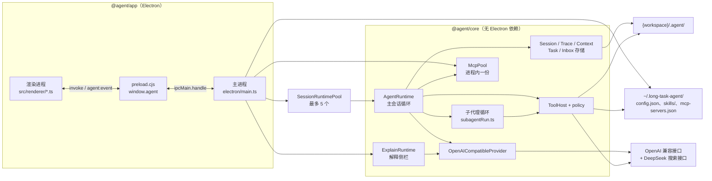

# 架构与运行机制

应用分两个进程、两个包。渲染进程只负责画界面，没有 Node；主进程用 `SessionRuntimePool` 按「工作区 + 会话」持有最多 5 个 `AgentRuntime`。运行时、存储、工具和模型客户端都在 `@agent/core`，不依赖 Electron，可以用 vitest 单独测。

一次发送就是一轮 ReAct 循环，也就是模型交替地推理和调用工具：装上下文，流式请求一个 OpenAI 兼容接口，执行模型给出的工具调用，再请求，直到模型不再调用工具。每一步写三份记录：模型下次能看见的对话、审计用的事件、每次请求实际发出的上下文。

## 术语

| 词 | 意思 |
| --- | --- |
| 轮（turn） | 一次发送带起的整段模型循环，有一个 `turn_id`。「允许这一轮」「停止这一轮」都指它 |
| 用户轮次 | 含有用户消息的一个 `turn_id`。自动标题按它计数，不算只有回执的续跑轮 |
| 批 | 模型一次回复里的一组工具调用 |
| 步 | `maxSteps` 的计数单位，一批算一步 |
| 回合 | 子代理里的「步」，上限是 8 或 16，父会话的 `maxSteps` 更小时取更小的 |
| 续跑轮 | 完成通知开出的一轮，不是你发送的 |

## 进程与包

## 不变量

这些约束是其余设计的前提，改动时先检查它们：

- **渲染进程没有 Node。** 窗口开着 `contextIsolation`、关着 `nodeIntegration`，页面内导航和新窗口一律拒绝。页面只经 preload 暴露的 `window.agent` 说话。工作台浏览器里的网页是另外的独立视图：单独的会话分区，没有 preload，所以它们碰不到 `window.agent`，也碰不到工作区。网址由用户输入，但只有 http、https 会加载，输入框的文本在主进程里规范化，界面传来的标签 id 只在主进程的标签表里查找。preload 必须是 CommonJS：tsc 先输出 `preload.js`，构建脚本再拷成 `preload.cjs`。
- **core 不依赖 Electron。** 许可和提问都是接口（`PermissionGate`、`AskGate`）。Electron 里接的是等界面回答的 `DeferredPermissionGate`、`DeferredAskGate`，测试里可以接 `AutoAllowGate`。
- **一个 runtime 对象同时只跑一轮。** 正在跑时再向同一条会话发送，得到 `busy`。续跑轮例外：第一条发送先暂存，排在回执后面，第二条才是 `busy`。不同会话各用各的对象，同时最多 5 个。
- **磁盘上的对话只追加，已有的行不改。** 短桩和整条丢弃只作用在这一次请求的副本上。悬空的工具调用有两道补齐：一轮开始、续跑和停止时，往 `messages.jsonl` 追加合成的 tool 消息；组请求时，再在副本上补一次。
- **一轮内不换模型配置。** 一轮开始时定下 Base URL、模型和密钥，这一轮里后面的每次模型调用都用这一份。
- **MCP 连接池是进程内一份。** 五个 runtime 共用。工具定义在每轮开始时拍进这一轮；子代理和解释侧栏不拿这些工具。见 [MCP](mcp.md)。

## Runtime 的生命周期

每个 `AgentRuntime` 在构造时绑定一个工作区。会话目录、沙箱和 shell 的工作目录都随这个对象定下来。同一工作区可以同时有多个对象，各管一条正在执行的会话；换工作区不再拆掉其他会话的对象。

在侧栏「模型」页，或在输入框旁的模型选择器里改当前模型，只重写 `~/.long-task-agent/config.json`，不碰正在跑的 runtime：权限确认和「等你回答」继续挂在原对象上。下一次点发送时，主进程比较 11 个字段：当前这条的 Base URL、模型、密钥、搜索地址、搜索密钥，加 6 项限额。有变化、且这一条既没有轮次在跑、也没有后台子代理，才丢掉旧对象，按新配置再建。模型和供应商是建对象时定的，所以生效方式是换对象，不是在跑着的对象上改字段。后台提取记忆固定走生文模型：当前选用的是生文就用它，否则用列表里第一条生文；一条都没有则这次不提取。

解释侧栏用另一个对象 `ExplainRuntime`，全局一份，按「工作区 + 配置」复用。它用 `currentExplainModelId` 指向的生文模型，缺省同样回退到一条生文模型，不改主对话的当前选用。它和主会话可以同时跑，见 [解释侧栏](#解释侧栏)。

## 一轮提问怎么走

1. 渲染进程调用 `submit(sessionId, text, images, videos, workspace, audios)`，主进程交给这条会话自己的 runtime；还没有对象、且未满 5 个时才新建。用户消息里的 `/技能名` 会把那个技能的正文附进这一轮；技能不存在或已停用时，这次提交直接被拒，什么都不写。麦克风听写不走 submit，只经 IPC 把 PCM 帧交给主进程 ASR WebSocket，把文本写回输入框。
2. 先补齐磁盘上悬空的工具调用，再追加 `turn_start`。若完成通知队列里有没写进对话的回执，先收成一条 `task-notification` 用户消息，再写你的这条消息。回执因此排在你这句话前面。
3. 用户消息落盘之后，按当前模型的 `kind` 分流，没有意图识别，失败也不会改走另一种类型：
   - 语音合成（`tts`）：不走工具循环。空文本拒绝。向 openspeech HTTP TTS 请求（忽略方舟 Plan Base URL），音频写入 `audios/`，助手气泡播放，`context.jsonl` 记 `kind: "tts"`。
   - 语音识别（`asr`）：不走工具循环。须恰好附 1 段音频；经 openspeech nostream WebSocket 转写，助手气泡出正文，`context.jsonl` 记 `kind: "asr"`。
   - 生图：不走下面的工具循环，也不带工具。提示词为空时提示「生图请先输入提示词」；这一轮若附了视频，提示「生图不发送视频，请先去掉视频，或改用生文模型」。这两类校验失败不写 `context.jsonl`。否则向 `${baseUrl}/images/generations` 发送 `model`、`prompt`、可选参考图，以及 `size`（档位或 `宽x高`）、`output_format`、`background`、`watermark`；5.0-pro 另发 `optimize_prompt_options.mode`。参数先取模型条目的默认值，再合并本轮 composer 覆盖；透明背景强制 `png`，且只在恰好一张参考图时发送，否则回退到非透明背景。不改写你填的 Base URL（只去掉末尾一个斜杠再接上路径），接受返回的 `b64_json` 或图片地址。生成的图写入 `images/`，在助手气泡里展示，并在 `context.jsonl` 记一行（`kind: "image"`，没有工具定义）。取消则中止这次请求。成功结束时仍会入队后台提取记忆。
   - 生视频：不走工具循环。提示词为空，或附件与当前默认素材模式不符时，提示后结束。否则按模型页里当前型号的默认素材模式、分辨率、时长、画幅，向派欧云 MiniMax H3 异步接口提交任务并轮询（Base URL 去掉末尾斜杠和可选的 `/v1` 后，走 `/v3/minimax/v2/...`）。文生可附 0～1 张图（一张时作首帧）；首帧/尾帧各需 1 张；首尾帧需按顺序附 2 张；**参考素材**可附图 ≤9、视频 ≤3、音频 ≤3（合计 ≤12，不能只附音频），content 使用 `reference_image` / `reference_video` / `reference_audio`。首帧/尾帧路径画幅用 `adaptive`；参考素材按设置页画幅（Lite 禁止 `adaptive`，会落到固定比例）。成功后把视频写入 `videos/`，在助手气泡里播放，并在 `context.jsonl` 记一行（`kind: "video"`，没有工具定义）。取消则中止创建或查询。成功结束时仍会入队后台提取记忆。型号 × 模式细则与 UI 映射见 [生视频用法要点](video-generation.md)。
   - 生文（或缺省、未知类型）：进入下面的工具循环。这一轮用户消息上的图片和视频会进出发请求。若用户让它生成或绘制图片、封面、插画，系统提示要求它简短告知改选生图模型后再发，不要用 SVG 或其他本地转换来绕过；在工作区里增改图片或 SVG 文件的编程任务仍允许。
4. 生文这一路循环，直到没有工具调用、被取消、出错，或到达 `maxSteps`（默认 50）：
   - 读出全部消息，按下一节的规则装成上下文，流式请求模型。文本增量以 `text` 事件推到界面。
   - 没有工具调用时，先排空完成通知。写出了回执就再请求一次模型，不结束这一轮；队列空了才发 `done`。
   - 有工具调用则 `steps` 加一。`maxSteps` 数的是「模型返回了一批工具调用」的次数，不是 HTTP 请求数。
5. 一批工具调用里，第一个 `ask_user` 之前的所有 `subagent` 用 `Promise.all` 一起跑，其余工具按顺序执行，只有一个例外：相邻的只读调用（`read_file`、`list_dir`、`keyword_search`、`read_skill`、`web_search`、`memory_read`，以及判为只读的 `bash` / `powershell`）两个及以上时一起跑。它们的开始记录和结果落盘都按模型给出的顺序进行；遇到写入、阻断、`ask_user` 或 `subagent` 就断开。任务工具和 MCP 工具不并发。只读调用若和紧挨着的上一次调用完全相同（中间没有别的调用，用户轮之间也不延续），第二次起不执行，返回一句说明。普通工具先过 `classifyToolCall`，见 [工具与权限](tools-and-permissions.md)；`ask_user` 直接进入提问流程；`subagent` 由 runtime 自己判断：`worker` 要确认，`explore` 直接启动。
6. 每次工具调用写一条 `tool_call` 事件，执行后追加 `role=tool` 的消息和 `tool_result` 事件，后者用 `request_id` 指回前者。这一批结果都写完，先排空完成通知，再回到第 4 步。
7. 已经执行了 `maxSteps` 批之后，模型再返回的那一批不执行：每个调用写成合成结果 `Skipped: reached max tool steps (N)…`，再追加一条助手提示，然后 `done(max_steps)`。默认值 50 的意思是前 50 批照常执行，第 51 批被跳过。
8. 满 3 个用户轮次（不算只有回执的续跑轮）、标题还是默认值时，取会话里前 10 条有正文的用户和助手消息、每条前 240 字，请求模型起一个标题，最多 12 个字，只起一次。用户手改过的标题不动。

一批里有三次 `web_search`，`steps` 只加一，但会打出三次搜索请求，外加这一轮的对话补全请求。搜索和 token 是两笔用量。

## 上下文怎么装

`assembleContext`（`packages/core/src/context/assemble.ts`）组出这一次请求。主会话、子代理、解释侧栏三套循环共用它。请求体是 `messages` 加上并列的 `tools`。没有按用户轮次把旧对话收成一条摘要。

**一次请求里的顺序：**

| 顺序 | 部分 | 处理 |
| --- | --- | --- |
| 1 | 系统提示 | 原样，放在 `system` 最前 |
| 2 | 指令文件和记忆 | 每轮开始读一次，这一轮的每次请求用同一份。两份 `AGENTS.md` 各最多 8000 字；`# Memory` 最多 6000 字，`user` 和 `feedback` 带正文，`project` 和 `reference` 只带一行。算进 system 的长度，从历史预算里扣掉。没有这些、并且自动记忆开着时，这一段不出现。见 [记忆](memory.md) |
| 3 | 已安装技能目录和使用规则 | 每步扫描已启用技能。一个都没装则不出现 |
| 4 | 这一轮附上的技能正文 | 用户消息里的 `/技能名` 在本轮开始读入。超过 8000 字只留前 8000 字，并写明后面还有多少字。没有 `/技能名` 则不出现 |
| 5 | 任务提醒 | 有未完成任务，且隔了 10 次没有使用任务工具的助手回复，才附在 `system` 末尾 |
| 5b | 批量提醒 | 连续 4 次只带一个工具调用的助手回复之后，附一句「可以放在同一次回复里」的提醒，接在任务提醒后面。只在本轮内计数，一次带两个及以上调用的回复会清零；不写入会话记录。见 `context/batchReminder.ts` |
| 6 | 最后一条之前的历史 | 按下表在副本上处理 |
| 7 | 最后一条消息 | 不参与丢弃。用户刚发的消息，或刚返回的工具结果 |
| 8 | 补齐的工具结果 | 有调用没有结果时补一条合成失败。不计入预算 |
| 9 | 图片、视频和音频 | 记录里只存相对路径。Chat 出站时：只有最后一条带图/视的用户消息可 inline；更早的图/视/音与助手媒体换成带路径的说明；音频永不 inline。生图/生视频/TTS 只发本轮。只有媒体、没有文字时，用「请看图片。」「请看视频。」「请看音频附件。」或「请看附件。」作为正文 |
| 10 | `tools` 数组 | 本轮开始时拍快照，和 `messages` 并列，不写入 `system`，也不从历史预算里扣。内置工具原样。MCP 说明截到 800 字，参数 Schema 不截断。子代理和解释侧栏的表里没有 `mcp__` 和 `memory_read` |

**历史的处理，全部只在发出去的副本上做，按这个顺序：**

| 步骤 | 规则 |
| --- | --- |
| 省略已落盘的写入 | 成功的 `write_file` / `str_replace` 参数超过 500 字时，只留路径和字数 |
| 省略已经看过的失败写入 | 失败的 `write_file` / `str_replace` 参数超过 500 字时，下一次请求仍带全文，方便重试。模型已经回复过之后，再往后的请求只留路径、字数，并带 `succeeded: false` |
| 省略早先读过的技能 | 之前用户轮次里 `read_skill` 的结果换成「此前读过技能 X 的正文。需要时再调用 read_skill。」同一用户轮次里，超出当前轮结果预算的 `read_skill` 全文也换成这一句 |
| 省略已经用过的工具结果 | 当前用户轮里的工具结果保持原文，但总字数有上限：最新一批的结果无条件保留，其余从新到旧累加，超过 `contextCharLimit` 的一半（`TURN_RESULT_SHARE`）就停，更旧的按下面的规则省略。之前用户轮的 `read_file`、`memory_read`、`list_dir`、`keyword_search`、`web_search`、`powershell` / `bash`、`mcp__*` 正文超过 500 字的，换成一行：工具名、路径或命令、原文字数；`memory_read` 写调用时的名字和字数。文件还在磁盘上就写明，该路径后来被成功写入就写明「之后被改过」。命令类写明「不要为了看旧输出而重跑」。`ask_user`、`task_*`、`subagent` 的结果不缩短 |
| 字数上限 | 预算 = `contextCharLimit` − system 长度 − 最后一条消息的正文和工具参数 − 100，至少 1000。历史里同样把 `tool_calls` 的参数算进去。先整对丢掉最旧的工具往返（助手消息和对应的 tool 消息一起走），再整条丢掉更旧的消息。最早的一条真实用户消息，以及受保护的工具结果（最新一批、当前轮预算内的结果），超预算也保持原文。不从正文中间切开。最后一条消息不参与这一步 |
| 补齐 | 没有结果的工具调用补一条合成的 tool 消息，避免请求因调用和结果不成对而失败。补出来的消息不计入预算 |

所以 `contextCharLimit` 是第 6 段历史的预算，不是整个请求的硬上限：`system`、最后一条消息、`tools` 数组和补齐出来的消息都可能让实际请求超过它。`llm_request` 的 `approx_chars` 把消息正文、工具参数和 `tools` 数组的字符数加在一起。

工具结果在执行时已经截过一次：`read_file` 和 `read_skill` 最多 `maxReadChars`（默认 5 万字），命令、搜索、列目录、网页搜索、MCP 和技能脚本最多 `maxToolOutputChars`（默认 2 万字）。子代理回给父会话的回执最多 6000 字。这些上限发生在写入会话之前，不是上表的丢弃。

## 事件流

runtime 把 `RuntimeEvent` 交给主进程。不少事件本身不带 `session_id`，主进程在转发成 `agent:event` 之前补上这条会话的 `session_id` 和 `workspace`，界面才分得清该画到哪一页。事件类型：

| 类型 | 用途 |
| --- | --- |
| `text` | 助手文本增量 |
| `tool_call`、`tool_result` | 工具条的开始和结果；子代理的事件带 `parent_tool_call_id` 和 `session_id` |
| `permission_request`、`ask_user` | 等人；带 `request_id`，界面回答时原样带回。这是等人的配对号，和 trace 里指回前一事件的 `request_id` 不是一回事 |
| `status` | 当前阶段：`assembling`、`llm`、`tool`、`awaiting_permission`、`awaiting_user` |
| `done` | 一轮结束：`completed`、`max_steps`、`cancelled`、`error` |
| `error` | 出错说明 |
| `session_title` | 自动标题 |
| `inbox_wake`、`task_notification`、`held_user` | 完成通知开出续跑轮、写入回执、续跑期间暂存的用户消息 |

后台提取写入记忆后发 `memory_saved`。它走 `agent:memory-event`，不进上面这张表，也不经过这个事件门。

每条正在执行的会话有自己的 `runEventGate.ts` 状态。这个纯函数决定事件属不属于这一轮：你正看着这条会话就画在主区，否则画进它缓存着的对话节点。子代理的工具行在父轮次结束后也按这个会话归属。这个函数有单独的测试脚本 `packages/app/scripts/test-run-event-gate.mjs`。

## 停止

点「停止」时，主进程只处理这一条会话：挂起的权限请求按拒绝处理、提问取消，再调用这个对象的 `cancel()`。已经流出的文本保留，标成 interrupted。正在跑的 shell 被结束，Windows 上用 `taskkill /T /F` 连子进程一起结束。尚未执行的工具调用用合成结果收口，并写 `cancel` 事件。按钮变成灰色的「正在停止」，直到这个 runtime 发出 `done`。别的会话不受影响。

已经受理的 `deferred` 子代理不会被停止取消；删除它所在的会话才会中止它，见 [子代理、任务清单与完成通知](subagents-and-tasks.md#停止)。

## 出错与恢复

- **模型请求失败**（密钥错、限流、上下文超长、断网）：写一条 `llm_error` 事件，界面显示错误，这一轮以 `done(error)` 结束。不自动重试。已经写进对话的内容都在，下一次发送从这里接着来。
- **工具出错**：变成一条 `is_error` 的工具结果交还模型，这一轮继续。子代理调用 `subagent` 或 `ask_user` 时同样得到一条错误结果，循环继续。
- **写磁盘失败**：这一轮以 `done(error)` 结束，然后尽力补齐悬空的工具调用；补不上的，下一次发送开头再补。
- **应用重启后**：会话、任务清单和完成通知队列都在磁盘上，下一次发送时先补齐悬空的工具调用。正在跑的那一轮断了，不会自动接着跑。`deferred` 子代理也断了：下次打开这条会话或再发送时，进程编号对不上的 `running` 记录会把领取的任务放回 `pending`，但不补发通知。它占用的 `output_dir` 锁只存在内存里，随进程一起消失。
- **重新加载页面**：当时正在执行的对象全部取消，后台子代理也停掉。磁盘上的会话还在，这一轮不会接着跑。

## 解释侧栏

右侧「答案解释」是一个简答助手：把会话里选中的一段文字拖进去，或右键选「解释」，它用 200 字以内作答，必要时调用 `web_search`，最多列 3 条来源。

它由 `ExplainRuntime` 驱动，和主会话分开：

- 自己的循环，唯一的工具是改写过说明的 `web_search`，不读技能，也不读任务提醒。只用生文模型，见配置里的 `currentExplainModelId`；没有可用的生文模型时不会发出请求。
- 不接收图片或视频。
- 从会话页拖出时，附上选区所在那一轮的用户正文和助手正文，每侧最多 4000 字（选区本身更长时整段保留），不带工具结果。
- 每个主会话一份解释记录，存在会话目录下的 `explain-*.jsonl`，重启后还在。
- 工作台的浏览器页借用同一个解释栏元素，但用另一份记录：界面传一对固定的值（`browser:explain`、`browser-explain`）代替工作区和会话，主进程把它换成 `~/.long-task-agent/browser-explain/` 并在第一次用时建好那条会话。网页内容因此不会写进任何工作区的 `.agent/`。解释栏仍然只有 `web_search` 一个工具。借用时，解释栏元素和它自己的展开按钮一起搬进浏览器页，栏自己决定显示还是隐藏，界面上没有另外的开关。网页是另一个进程里的原生视图，界面读不到它的选区，所以文字只从两条路进来：网页右键菜单由主进程发来一条事件，或把选中的文字从网页拖到栏上。拖放只认纯文本，文件、应用内自己的拖放（它们有自己的处理）和落在输入框里的都不算。
- 同一时刻全局只跑一个解释，可以和主会话同时进行。

## 模块地图

### `@agent/core`（`packages/core/src`）

| 模块 | 职责 |
| --- | --- |
| `runtime/agentRuntime.ts` | 主会话的状态机：落库、组上下文、流式调用、执行工具、许可、取消、完成通知、自动标题。一个对象一轮 |
| `runtime/sessionRuntimePool.ts` | 按工作区和会话持有这些对象，同时最多 5 个 |
| `runtime/subagentRun.ts` | 一个子代理的独立循环。自己的上下文，回给父会话的只有一条回执 |
| `runtime/explainRuntime.ts` | 解释侧栏的循环 |
| `runtime/permission.ts`、`runtime/askGate.ts` | 许可门和提问门的接口与实现 |
| `context/assemble.ts`、`compress.ts`、`repairToolCalls.ts`、`images.ts`、`taskReminder.ts` | 组上下文，规则见上文 |
| `provider/openaiCompatible.ts` | 把上下文打成 chat-completions 流，解析文本、工具调用和用量；生图与生视频也从这里接到 provider |
| `provider/videoGeneration.ts` | 派欧云 MiniMax H3：拼创建任务体、轮询查询、下载结果 |
| `config/videoOptions.ts` | 四个 H3 型号的约束、默认参数与校验 |
| `store/*.ts` | 会话、事件、上下文、任务、完成通知、子代理、解释的落盘，见 [数据模型](data-model.md) |
| `tools/*.ts` | 内置工具、分级、路径沙箱，见 [工具与权限](tools-and-permissions.md) |
| `skills/*.ts` | 技能的安装、目录、正文附加，见 [技能](skills.md) |
| `memory/*.ts` | 指令文件、记忆的存储和渲染、每轮快照、后台提取。见 [记忆](memory.md) |
| `mcp/*.ts` | MCP 连接池、stdio 与 Streamable HTTP、工具名和打码，见 [MCP](mcp.md) |
| `config/loadConfig.ts`、`config/agentHome.ts`、`config/homeMeta.ts` | 读写 agent home 下的 `config.json`、按检出隔离 home、`home.json` 显示名 |
| `session/autoTitle.ts` | 自动标题 |

### `@agent/app`（`packages/app`）

| 模块 | 职责 |
| --- | --- |
| `electron/main.ts` | 窗口、中文菜单、工作区、全部 IPC、会话 runtime 池和解释 runtime 的生命周期、技能目录监视。MCP 的 IPC 在 `electron/mcpIpc.ts`，进程退出时关掉连接池。记忆页的 IPC 和提取器在 `electron/memoryIpc.ts`：一轮正常结束就入队，进程退出时和连接池一起关掉。 |
| `electron/preload.ts` | 页面唯一能用的 API：`window.agent` |
| `electron/browserTabs.ts`、`browserPolicy.ts` | 工作台里的浏览器：标签列表只在主进程，界面发命令（新开、切换、关闭、前进后退、地址栏文本），主进程回推状态。每个标签是一个 `WebContentsView`：不带 preload，开 `sandbox` 和 `contextIsolation`，拒绝除剪贴板写入和全屏外的全部权限；只加载 http、https，新窗口开成新标签。DeepSeek 标签用自己的会话分区，只留在 `deepseek.com`，可以关闭，也可以从空标签的按钮或地址栏里输入 DeepSeek 的地址重新打开；DeepSeek 站点的地址只会在这个标签里加载，所以它的登录不会被别的标签看到，也不会有一个没登录的 DeepSeek 副本。其余标签共用另一个分区。关掉最后一个标签会补一个空标签。空标签不创建视图。关闭工作台只是把视图藏起来并静音，不销毁，再打开时原样回来。网页要求全屏（视频的全屏按钮）时，Electron 自己让窗口进入全屏，但视图仍是工作台里那块小区域，所以 `layout()` 在这期间让该标签的视图铺满窗口内容区，忽略界面报来的区域，退出后再还原；切标签、关工作台、关标签时先让页面退出全屏再继续，页面还没完成进入全屏时则挂一个两秒的监听，到了就退出，免得窗口留在全屏里。标签的网址变化时交给 `browserTabsStore.ts` 防抖写进 `~/.long-task-agent/browser-tabs.json`，退出时再写一次；重启后读回来的标签没有视图，切到它时才加载，所以启动不会一次开出所有页面。读回来的文件当作不可信输入：不是 http、https 的丢掉，数量封顶。纯规则（地址规范化、站点判断、坐标换算、存哪些标签、怎么读回）在 `browserPolicy.ts`，写文件在不依赖 Electron 的 `browserTabsStore.ts`，都有单独的测试脚本 |
| `electron/openTarget.ts` | 打开链接和本地路径。网址交给浏览器；目录直接打开；文件只在文件夹里选中，不执行 |
| `electron/taskbar*.ts` | Windows 任务栏提醒：有权限卡或提问卡在等、而你没在看时，图标每 530 毫秒切换一次。Win32 库到第一次换图标时才加载 |
| `src/renderer/main.ts` | 工作区与会话列表、页面切换、事件订阅、发送与停止、页内搜索、草稿 |
| `src/renderer/ui.ts` | 消息气泡、Markdown、工具条、权限卡和提问卡。不持有会话状态 |
| `src/renderer/explainPane.ts`、`skills.ts`、`mcp.ts`、`models.ts`、`videoModelForm.ts`、`taskPanelView.ts`、`questionNav.ts` | 解释侧栏、技能页、连接页、模型页（含生视频四型号表单）和输入框旁的模型选择器、任务面板、问题轨 |
| `src/renderer/questionsOnly.ts` | 「只看用户问题」的过滤，主区和解释栏共用：开着时未展开的轮次只留问题气泡，点气泡展开或收起这一轮，查找跳过被藏起来的文字 |
| src/renderer/composerCollapse.ts | 输入框的收起与展开：没在用时收成一行；焦点、草稿、会话未开始或等你回答时展开。主输入框和解释栏共用 |
| `src/renderer/workbench.ts` | 「我的工作台」的开关、菜单和常用文件夹页；选中的菜单项记在 `localStorage` 的 `workbench.page`，启动时读回来，不认识的值当作第一项 |
| `src/renderer/browserExplain.ts`、`electron/browserExplain.ts` | 浏览器页借用解释栏：进入时把解释栏和它的展开按钮搬进页面并改绑到浏览器自己的记录，离开时搬回原位，并接收网页拖来的文字。记录的建立和固定的标识在主进程一侧 |
| `src/renderer/explainDrag.ts` | 解释栏的拖放：应用内拖放的类型名，以及网页拖来的纯文本的取舍和截断（纯函数，有测试） |
| `src/renderer/browserView.ts` | 浏览器页的标签栏和地址栏。网页是原生视图，界面里只有一个占位框：量出它的位置交给主进程，并在滑入动画、窗口缩放时跟着改 |
| `src/renderer/memory.ts`、`memoryView.ts` | 记忆页，以及对话末尾的「已记住」 |
| `src/renderer/runEventGate.ts` | 丢掉不属于当前会话或轮次的事件 |
| `src/renderer/escapeKey.ts` | Esc 先关什么、什么时候才停止这一轮 |

渲染层的分工：`main.ts` 决定现在看哪一页、这轮算不算当前会话；`ui.ts` 只把一块内容画成 DOM；其余几个文件各管一块界面，不持有会话。
