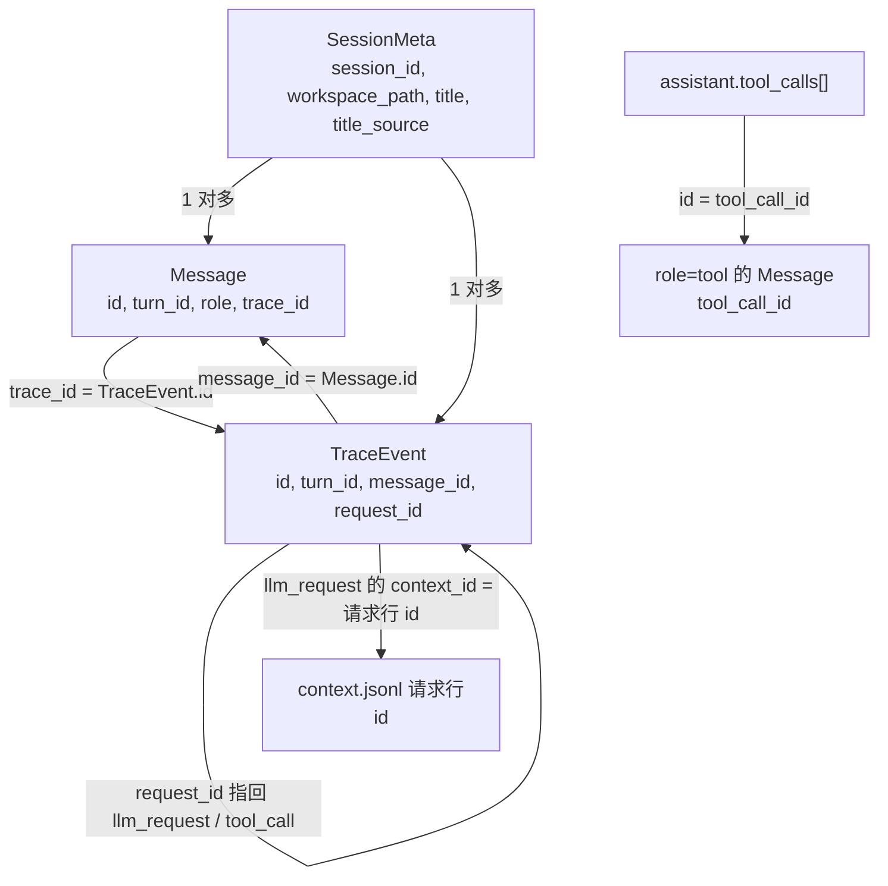

# 数据模型

数据落在两处，互不写入。用户目录 `~/.long-task-agent/` 放配置和技能，跟着人走。工作区下的 `.agent/` 放会话，跟着项目走。换工作区不会串历史，密钥也不会进项目目录。

每个会话有三份日志，各回答一个问题：模型下次能看见什么（`messages.jsonl`）、发生过什么（`trace.jsonl`）、某次请求到底发了什么（`context.jsonl`）。三者用 id 互相指认。

## 落盘位置

```text
~/.long-task-agent/
  config.json                    模型配置、工作区列表、可选限额。POSIX 上目录 0700、文件 0600
  skills/<name>/                 已安装的技能，见 skills.md
  skills/.skill-settings.json    停用的技能名单

{workspace}/.agent/sessions/{sessionId}/
  meta.json                      会话身份：id、工作区路径、标题、标题来源、时间
  messages.jsonl                 模型下次能看见的对话，一行一条 Message
  trace.jsonl                    审计事件，一行一条 TraceEvent
  context.jsonl                  每次模型调用实际发出的上下文
  images/                        随消息上传的图片 img_*，解释侧栏的图片 explain-img_*
  inbox.jsonl                    完成通知队列。不在对话里，排空后才写进 messages.jsonl
  tasks/                         本会话的任务清单
    {id}.json                    一个任务。编号是十进制字符串，删掉也不复用
    .highwatermark               用过的最大编号
    .lock                        修改清单时临时创建的锁文件
  subagents/{subagentId}/        一次 subagent 调用的独立落盘，不是另一个会话
    meta.json                    类型、父工具调用 id、output_dir、状态
    messages.jsonl  trace.jsonl  context.jsonl
  explain-meta.json              解释侧栏的状态
  explain-messages.jsonl  explain-trace.jsonl  explain-context.jsonl
```

`sessionId` 只能由字母、数字、下划线和连字符组成，避免拼进路径时逃出 `.agent/sessions/`。列会话只看 `sessions/` 的直接子目录，所以 `subagents/` 和 `tasks/` 不会被当成会话。

## 三份日志

| 文件 | 回答的问题 | 谁读 |
| --- | --- | --- |
| `messages.jsonl` | 模型下次能看见什么 | runtime 组上下文；界面画对话 |
| `trace.jsonl` | 发生过什么、按什么顺序、花了多久 | 审计；界面的文件页 |
| `context.jsonl` | 某次请求实际发出了什么 | 排查模型为什么这样做 |

拆成三份，是因为它们的用途不同：`messages` 是模型的工作记忆，发出前会在副本上压缩和省略；`trace` 记录动作本身；`context` 存下压缩之后实际发出的样子，压缩出了问题能对回去。三份文件本身都只追加。

<!-- 待作者确认：拆三份的理由是推测，请按你的原意改。 -->

### `messages.jsonl`

一行一条 `Message`：`id`、`session_id`、`turn_id`、`role`、`content`、`created_at`，以及按需出现的 `images`、`name`、`tool_call_id`、`tool_calls`、`is_error`、`trace_id`、`interrupted`。

`role=tool` 的消息可以带 `tool_call_arguments`，只给界面和审计看。组装上下文时不会再发给模型，因为参数已经在配对的那条助手消息的 `tool_calls` 上。

### `trace.jsonl`

一行一条 `TraceEvent`：`id`、`session_id`、`turn_id`、`type`、`timestamp`，以及按需出现的 `message_id`、`request_id`、`token_usage`、`error`、`detail`。

主会话的事件类型有 `turn_start`、`user_message`、`llm_request`、`llm_response`、`llm_error`、`tool_call`、`tool_result`、`max_steps`、`cancel`。

各类型的具体内容放在 `detail` 里：

- `user_message` 只记字数、图片张数，以及这条消息是不是续跑期间暂存的（`held`），不记正文。
- `llm_request` 只记模型名、条数、字数、图片张数和 `context_id`。`context_id` 就是这条事件自己的 `id`，`context.jsonl` 里对应的请求行也用这个 `id`。
- `llm_response` 记助手全文和工具调用，`tool_call`、`tool_result` 记参数和完整输出。所以 trace 不只是索引，里面有正文。
- `tool_result` 的 `duration_ms` 只出现在真正执行过的调用上，不算等你点允许的时间；被拒绝和被停止的调用，分别带 `denied: true`、`cancelled: true`。

事件类型里没有单独的「许可决定」，许可结果体现在 `tool_result` 上。正常结束一轮也不写 trace，只发给界面一个 `done` 事件；到达上限和被停止各有一条 `max_steps`、`cancel`。

### `context.jsonl`

两种行：

- `{type: "tools", sha256, tools}`：一份工具定义，同一个哈希只写一次。
- `{type: "request", id, turn_id, model, tools_sha256, messages}`：一次请求。每条消息记角色、正文、`name`、`tool_call_id`、`tool_calls`；图片只记路径和字节数，不存像素。

system 正文里的 `# Tools` 说明每行都会出现，去重只省掉了 API `tools` 参数那一份。

## 标识与关系

id 的格式是 `<前缀>_<32 位十六进制>`。前缀有 `sess`、`turn`、`msg`、`trace`、`perm`、`ask`、`subagent`、`note`、`img`。deferred 子代理的完成通知 id 是 `note_<子代理 id>`，所以同一个子代理只会入队一次。早先的子代理目录叫 `agent_…`，现在仍能读。



一条用户消息打开一个 `turn_id`。这一轮里的助手文本、工具调用和工具结果都带同一个 `turn_id`。`llm_response` 和 `llm_error` 用 `request_id` 指回对应的 `llm_request`；`tool_result` 用 `request_id` 指回它的 `tool_call`。

有几处例外：取消时写的 `llm_response` 没有 `request_id`；完成通知消息，以及一轮开头、续跑和存储失败时补齐出来的 tool 消息，没有 `trace_id`，也不写事件；自动标题那次模型调用不进 trace，也不进 context。停止时补的「Cancelled」tool 消息不算例外：它们有 `trace_id`，也写 `tool_call` 和带 `cancelled: true` 的 `tool_result` 事件。

## 图片

每张最大 1,500,000 字节，每条消息最多 4 张，格式是 PNG、JPEG、WebP、GIF。主输入框和解释侧栏上传前都会重新编码：长边缩到 1600 像素，PNG 保持 PNG，其余转成质量 0.86 的 JPEG，GIF 只留第一帧。主输入框还多一步：编码结果超过 900,000 字节时，改成质量 0.8 的 JPEG，PNG 也一样。

消息里只记 `images/` 下的相对路径。组请求时，只有最后一条用户消息上的图片会变成像素；子代理从不发像素。

## 配置

`~/.long-task-agent/config.json` 的字段见 [README 的配置表](../README.md#配置)。

- 保存时先读回磁盘上的配置再合并，所以手改的限额不会被界面的保存冲掉；但写入是整份重写。
- 目录 chmod 0700，失败会被忽略；文件以 0600 创建，之后再 chmod 一次。Windows 上 chmod 基本不起作用，文件靠用户目录本身的权限保护。
- 读取时去掉 BOM，并对 Base URL、模型、密钥去掉首尾空白。
- 文件解析失败时，退回默认值和空密钥，不报错。
- 密钥明文保存，只靠文件权限保护。

## 什么不会写进日志

- 配置里的 `apiKey` 不由 runtime 写进三份日志。
- `user_message` 事件只记字数、图片张数和 `held`。
- `tool_call_arguments` 只给界面看，不发给模型。

注意边界：shell 读到的任何内容、网关返回的错误正文，都会原样写进日志，见 [安全模型与已知边界](tools-and-permissions.md#安全模型与已知边界)。
